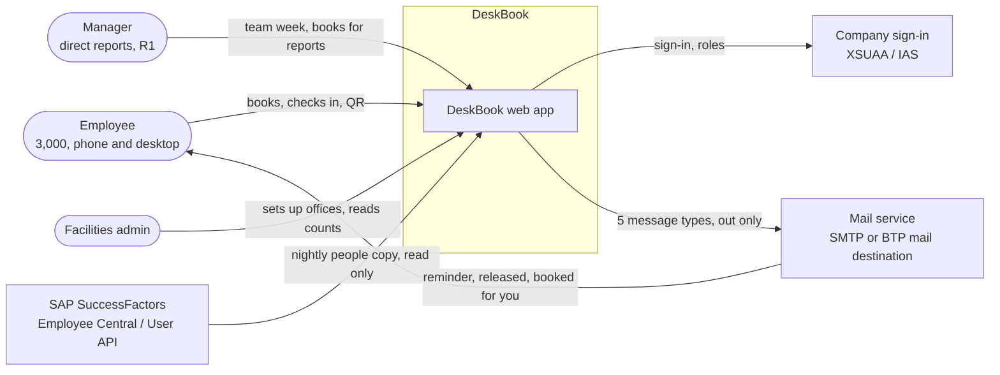
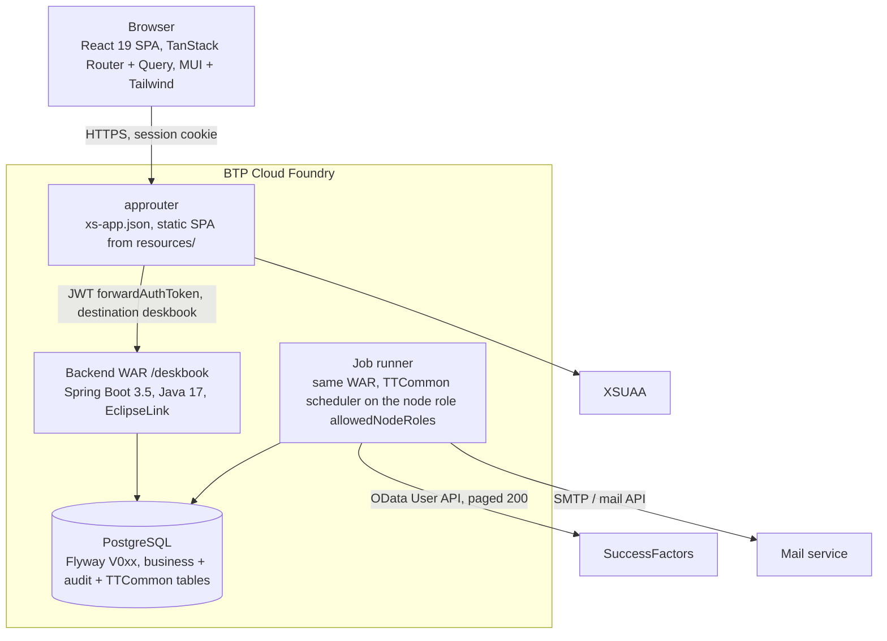
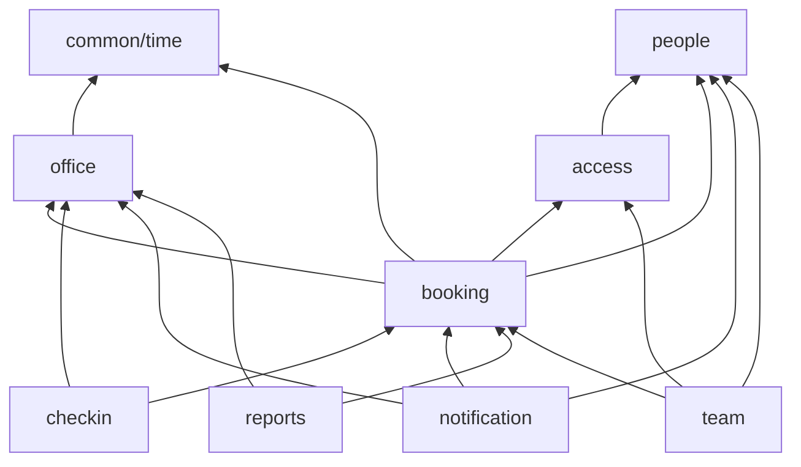
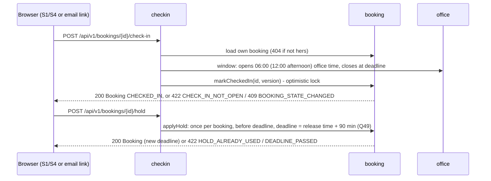
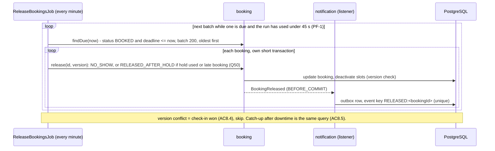

# Architecture - DeskBook

Stage S5 (solution-architect), 2026-10-28. Inputs: `02-spec.md` (first version), `03-journeys.md`,
`03-product-review.md`, `04-stories.md` + `04-backlog.csv`, `decisions.md` D1-D3, `questions.md` Q1-Q60.
D2 is applied where the spec is not revised yet (P1 same-day booking with a 30-minute check-in, P2 15-minute
reminder and one "Running late" hold, P3 no per-person no-show count for managers, P5 words, P10 trimmed
release 1). The product root is not built in this demo: the design stands on `base/BASE-SPEC.md` (B1-B9).

Scope: every MVP story task has a side and an operation id (section 5). R1, R2 and Later stories get their
module and operation ids only (section 5.3).

Assumed placeholders (B0.1): `{{productName}}` DeskBook, `{{productSlug}}` `deskbook` (context path
`/deskbook`, no hyphen because it is also the xsappname and cookie name), `{{basePackage}}`
`com.talenteam.deskbook`, `{{cssPrefix}}` `dsk`.

## 1. Context (C4 level 1)



| External system | Direction | What | When | Owner in DeskBook |
|---|---|---|---|---|
| XSUAA via approuter (B3) | in | identity, role collections | every request | base (TTCommon auth), `access` module maps roles |
| SuccessFactors (B5 connection, B5.9 readiness) | in only (R48) | user id, name, email, manager, home office, active | nightly + hourly retry | `people` module |
| Mail service | out | F13 messages (MVP: pre-release reminder, released) | on event, via outbox | `notification` module |
| Excel file (MVP, D7) | out | report rows | on request | `reports` module |

## 2. Containers (C4 level 2)



| Container | Owns | Does not |
|---|---|---|
| SPA (`Frontend/`) | screens S1-S19, labels and i18n, formatting dates in the office timezone given by the backend, theme tokens, empty/loading/error/no-permission states, polling (R1) | any business rule (date picker reads `getBookingCalendar`), any third-party call, business data in local storage |
| approuter (B3) | sign-in, CSRF/session, routes `/deskbook/api/public/*` (no auth) and `/deskbook/*` (xsuaa), serving the SPA | business logic |
| Backend WAR | every rule, authorization per operation and per record, persistence, audit (B6), OpenAPI contract `05-openapi.yaml` | UI sentences (returns codes; emails are the one place it renders text, from `messages.properties`) |
| Job runner | release, reminders, dispatch of mail, people sync (and R1/R2 jobs); TTCommon `BaseJob` (B4.1), registry tables JOB_SCHEDULER/JOB_RESULT | runs in request threads; jobs are on the node with the job role only |
| PostgreSQL | business tables per module prefix, `aud_*` partitioned (B6.4), TTCommon platform tables, CONFIGURATION for company booking rules | stored procedures or triggers with business rules |

The backend is stateless (session in TTCommon SPRING_SESSION tables, B1.27); it scales horizontally. Jobs run
on one node role; every job is idempotent anyway (ADR-4).

## 3. Modules

One deployable, modular by package (ADR-1). Backend `{{basePackagePath}}/<module>/{controller, service,
repository, domain, dto, mapper, event, job}`; frontend `src/features/<module>/{api, components, hooks, lib,
types, schemas, queryKeys.ts}` (B2.30, B9.1). Table prefixes go to data-architect.

| Module (spec) | Backend owns (tables, proposed prefix) | Public service API other modules may call | Frontend feature | Release |
|---|---|---|---|---|
| `common/time` (EN-2) | nothing; pure `PartOfDayRules` (no Spring, no DB) | `PartOfDayRules` functions | `lib/officeTime.ts` formatting only | MVP |
| `office` (M1) | offices + settings, floors, zones, desks, desk features, closed days, blocks (R1) - `ofc_` | `OfficeQueryService` (open offices, desk lookups, capacity per day), `OfficeClockService` (deadline, cut-off, working day per office), ports it declares: `BookingImpactPort` | `office-admin` (S10-S15) | MVP (+R1 blocks, import, QR) |
| `people` (M7) | employees projection, sync runs - `ppl_` | `PeopleService` (find by user id, active, manager of, reports of, last good copy), event `EmployeeLeft` | `people-admin` (S18 tab, R1) | MVP (status page R1) |
| `access` (M8) | access list (R1) - `acc_` | `DeskAccessGuard` (requireEmployee, requireAdmin, requireManagerOf, canSeeReserved), `getMyProfile` | `access` (S6 states, route guards; S16 R1) | MVP |
| `booking` (M2) | bookings, booking slots - `bkg_`; company booking rules in ConfigService group `DESKBOOK` (ADR-11) | `BookingCommandService` (create, cancel, mark checked in, apply hold, release, complete), `BookingQueryService`, `BookingStatsQuery` (aggregates for reports), implements `office.BookingImpactPort`, events `BookingReleased`, `BookingCancelled`, `BookingCreatedForOther` | `booking` (S2-S4), `today` (S1) | MVP |
| `checkin` (M3) | no table; owns `CheckInPolicy` (window, late deadline, hold) and the release/complete jobs | none (top of the graph for its jobs) | `checkin` (buttons; S5 desk page R1) | MVP (QR R1) |
| `notification` (M6) | outbox / notification log - `ntf_` | `NotificationService.enqueue(eventKey, type, recipient, payload)` (called only from its own listeners) | none in MVP (log page R1) | MVP |
| `reports` (M5) | search log (R1) - `rpt_` | none | `reports` (S17) | MVP (export is MVP, D7; success share R1) |
| `team` (M4) | manager delegates (R1) - `tm_` | none | `team` (S7-S9) | R1/R2 |

Rule: a module reads or changes another module's data only through that module's public service; no
repository is injected across modules; no JPA relation crosses a module (cross-module references are ids).



Arrows point to the module that is depended on. No cycles. The two reverse needs are inverted:
`office` needs "are there future bookings on this desk/floor/office/day" and (R1) "cancel them" - it declares
`BookingImpactPort`, `booking` implements it. `people` needs "cancel a leaver's future bookings" - it
publishes `EmployeeLeft`, `booking` listens (same transaction, `@EventListener`). Notifications listen to
booking events with `@TransactionalEventListener(phase = BEFORE_COMMIT)` and write the outbox row in the same
transaction (ADR-5).

Base changes this product makes: B8 demo module (Projects, Tasks, V004 migration, FE feature, routes, labels)
removed as one module; base dashboard (B2.10) replaced by Today at `/dashboard`; sidebar items per section 6
of `03-journeys.md`; two Settings tabs added (Booking rules MVP, People sync R1). The phone slide-over menu
(Q44, Q56) is a base change outside this backlog.

## 4. Flows

Where rules run: always in the backend service of the owning module; the SPA repeats only "field required" and
"date in the list" checks for fast feedback.

### 4.1 Find and book (J1 steps 1-3; BK-1, BK-5, BK-6, BK-7, PP-4)

```mermaid
sequenceDiagram
  participant B as Browser (S2)
  participant A as approuter
  participant BK as booking
  participant AC as access
  participant P as people
  participant O as office
  participant DB as PostgreSQL
  B->>A: GET /api/v1/bookable-offices, /calendar?officeId
  A->>BK: listBookableOffices, getBookingCalendar
  BK->>O: open offices, OfficeClock (working days, closed days, horizon, part ended?)
  B->>A: GET /api/v1/free-desks?officeId&date&part&page
  A->>BK: listFreeDesks
  BK->>AC: requireEmployee, canSeeReserved (R1)
  BK->>DB: desks of open office, active floor, not retired, minus active slots for date/half
  BK-->>B: page of desks (code, floor, zone, features), totalFree
  B->>A: POST /api/v1/bookings (Idempotency-Key)
  A->>BK: createBooking
  BK->>P: employee active and in copy? else 422 PROFILE_NOT_READY / EMPLOYEE_INACTIVE
  BK->>O: OfficeClock: working day, not closed, within horizon, part not ended, deadline
  BK->>DB: insert booking + 1-2 slots (one tx)
  DB-->>BK: unique violation slot -> 409 DESK_JUST_TAKEN; employee-day -> 409 ALREADY_BOOKED_THAT_DAY
  BK-->>B: 201 Booking (deadline, deadlineKind NORMAL or LATE, allowed actions)
```

Rules in `createBooking`: horizon and working day (R14, R19), one active booking per employee per day (R17,
DB unique), desk free for the part (R13, DB unique on slots, ADR-2), desk/floor/office bookable now (R21),
same-day booking until the part has ended (P1, BK-7), profile ready and active (PP-4, AC5.9). The deadline is
computed once here by `OfficeClockService` + `CheckInPolicy`: normal = release time of the part in office time;
late (booked after that release time) = booked-at + 30 minutes (CI-6), stored as a UTC instant (ADR-3).

Plan my days (D5, ADR-12): browser -> `proposeDesks` (booking: `DeskProposalRules` over `OfficeQueryService`
free desks and her own last 60 days) -> she changes a day through `listFreeDesks` -> `createBookings`: for
each day in date order `BookingCommandService.create` in its own transaction; on `DESK_JUST_TAKEN` for a
PROPOSED desk the proposal runs again for that day and books the next desk (REPICKED); any other refusal
is a FAILED day; booked days stay booked. All rules of 4.1 run per day.
Reads are set-based (PF-2, PF-3): `proposeDesks` reads the occupied desks of all chosen dates in one index-only
query on `ix_bkg_bookings_office_date` and runs `DeskProposalRules` in memory per day; `createBookings` builds one
`BookingContext` per request (person, profile, office and `OfficeClock`, closed days, check-in policy, usual desk,
desk list) that every day's `create` uses, so only the inserts repeat per day. A re-pick re-reads that day's
occupied desks only; at most 2 re-picks per day, then FAILED.

### 4.2 Check in and hold (J1 step 5; CI-1, CI-7)



The email links open the SPA route (`/bookings?focus=<id>&action=hold`); the SPA calls the operation after
normal sign-in. No signed links that act without sign-in (R25 applies to email links too).

### 4.3 Release (J2; CI-4, CI-5, CI-6, NT-3, BK-12)



One run drains the peak: 720 bookings due at 10:00 (5 years) x ~15 ms = ~11 s in the first run. A run that
reaches 45 s stops between bookings and the next run continues with the same query (no lock across batches).

### 4.4 Notifications (NT-1, NT-2)

`PreReleaseReminderJob` (every minute) finds BOOKED bookings whose deadline is 14-15 minutes away (window
`(now+14m, now+15m]` plus any missed `(now, now+14m]` not yet reminded) and enqueues event key
`PRE_RELEASE:<bookingId>:<deadline epoch>`. `NotificationDispatchJob` (every minute) sends PENDING rows through
the `MailSender` port; failures retry at +20, +40, +60 minutes, then FAILED with `addError` in the job result
(visible on the base Background Jobs page). A mail failure never touches the booking (R46).

### 4.5 People copy (PP-1 to PP-4)

```mermaid
sequenceDiagram
  participant J as PeopleSyncJob (hourly; works once per day)
  participant P as people
  participant SF as SuccessFactors (base SuccessFactorsClientService)
  participant BK as booking (listener)
  J->>P: skip if a run RUNNING (AC14.8) or a SUCCESS run exists for today
  P->>P: requireSuccessFactorsReadyForSync (B5.9)
  loop pages of 200
    P->>SF: User API $select userId, names, email, status, manager, location
    P->>P: upsert employees; skip records without email (counted)
  end
  P->>P: derive manager status (R52), mark missing/inactive as left
  P-->>BK: EmployeeLeft(id) per leaver -> cancel future bookings, no email (R51)
  P->>P: sync run SUCCESS with counts; on any failure FAILED, last copy stays (R49)
```

Hourly schedule with "already succeeded today" guard gives the nightly copy plus the hourly retry (R49) with
one job (ADR-6).

### 4.6 Admin setup (J4; OS-1 to OS-9) and report (J5; RP-1 to RP-3)

Admin screens call `office` operations; every write is an audited entity change (B6) with `If-Match` version
(AC1.6). `updateOfficeSettings` applies from tomorrow (R10): `office` publishes `OfficeSettingsChanged`,
`booking` recomputes the stored deadline of BOOKED bookings dated tomorrow or later in that office (ADR-3).
Closing an office, retiring a floor or desk, or adding a closed day with future bookings is refused in MVP
(422 `HAS_FUTURE_BOOKINGS` with the count, through `BookingImpactPort`); R1 (OS-11, OS-12) turns the refusal
into "N bookings will be cancelled, confirm" (Q61).

`getOccupancyReport` (admin) asks `BookingStatsQuery` for per office/floor/day counts (booked desk-days,
checked-in, no-show, released after hold, cancelled before deadline) and `OfficeQueryService` for capacity
desk-days (desks bookable on that day, ADR-10). Counts only; no ids or names in the response (R39).

## 5. Task split

Sides by `standards/fe-be-split.md`. Operation ids are for `api-designer` (verbNoun). Paths in section 8.1
are proposals.

### 5.1 Changes to the story-sizer's first cut

1. `getManagerStatus` (PP-2) is folded into `getMyProfile` (access): one call gives roles, manager status,
   profile readiness and last copy date for menu, guards and S6 (PP-4, PP-5).
2. Added `listBookableOffices` and `getBookingCalendar` (BK-1, BK-7): which dates and parts are bookable is a
   business rule; the date picker reads it instead of computing horizon, closed days and cut-offs itself.
3. `logSearch` (RP-6) is not an operation: `listFreeDesks` records the search outcome server-side, so the
   success number cannot be skewed by the client.
4. BK-6 adds an `Idempotency-Key` header on `createBooking` (AC5.4 double click returns the same booking)
   on top of the database uniqueness.
5. MVP has no block/cancel flow: close office, retire floor/desk and add closed day are refused while future
   bookings exist (OS-2, OS-3, OS-5, OS-8), until OS-11/OS-12 in R1 (Q61).
6. EN-1 gets a BE task: remove the B8 demo module (backend package, V004 migration, contract part).
7. RP-3 gets a DB task: desks keep `bookable_from` and `retired_on` dates so past capacity stays right after
   a desk is retired (R40, AC2.9).
8. NT-1 "admin sees failed sends": MVP shows them in the dispatch job results on the base Background Jobs
   page; `listNotifications` is R1 with the People sync tab.
9. CI-4 runs every minute, not every 5 minutes: with the scheduler start latency (B4.2, ~75 s) a 5-minute
   schedule can miss the 5-minute promise (R30).
10. BK-2 "remember last office and part": read from the last booking (`getBookingPreferences`, read only); no
    preferences table.
11. RP-9 `AnonymiseJob` belongs to `booking` (owner of the rows), not `reports`.

12. Gate GP (D5, option A "Plan my week", ADR-12): ST-BK-8 moves into the MVP and now also covers "Plan my
    days" (several days in one action, Q90). R1 `bookBestDesk` is replaced by `proposeDesks` (read: one proposed
    desk with a reason per chosen day) and `createBookings` (each day its own booking, per-day result, a taken
    proposed desk is re-picked). The "Change" picker is `listFreeDesks` (option B's zone-grouped list).
    `getToday` adds the usual desk (R1 after D6, item 14). Facilities' heat grid (zones x days) is `getOccupancyGrid`; option B's
    table under it stays `getOccupancyReport`. QR check-in at once (Q91) stays R1 (`checkInByDesk`).
13. Q83/Q88: three small daily purge jobs, one per owning module (6.3); the B8 demo `V004` migration is deleted.

14. G3 (D6, design review M2): no R1 work inside MVP stories. The two-week strip ST-BK-15 moves into the MVP and
    is served by `getToday` (`nextTwoWeeks`, 14 office-local days, own data, PF-12), not by `listMyBookings` +
    `getBookingCalendar`. The usual-desk card ST-BK-16 (`getToday.usualDesk`) and the heat grid ST-RP-10
    (`getOccupancyGrid`) are R1 tasks in 5.3; MVP Reports is the occupancy table (S17). Usual desk (Q97): the desk
    she booked most in that office in the last 60 days, at least 3 times, a tie goes to the most recent; the same
    rule gives `proposeDesks` its USUAL_DESK reason (ST-BK-8, MVP). External users are not copied (Q109, 4.5);
    a closed office is final (Q84); the mail sender takes at least 300 mails a minute (Q125, 6.5).

### 5.2 MVP (34 stories)

| Story | Task | Side | Operation | Module |
|---|---|---|---|---|
| ST-BK-1 | S2 office, date, part pickers; desk list with count, scroll paging, empty state | FE | `listBookableOffices`, `getBookingCalendar`, `listFreeDesks` | booking |
| ST-BK-1 | Free desks for office, date, part: open office, active floor, active desk, no active slot; page + totalFree | BE | `listFreeDesks` | booking |
| ST-BK-1 | Open offices for the picker with timezone and today's local date | BE | `listBookableOffices` | booking |
| ST-BK-1 | Bookable dates and parts within the horizon with the reason per refused day (weekend, closed, beyond horizon, part ended) | BE | `getBookingCalendar` | booking |
| ST-BK-1 | Indexes for the free-desk query (desks by office/floor/status; slots by desk/date/half) | DB | - | booking, office |
| ST-BK-5 | S3 confirmation: desk, office, date, part, check-in deadline, how release works | FE | `createBooking` | booking |
| ST-BK-5 | Create booking with all rules (R13, R14, R17, R19, R21), deadline from OfficeClock + CheckInPolicy | BE | `createBooking` | booking |
| ST-BK-5 | Read one own booking (confirmation reload, email deep links) | BE | `getBooking` | booking |
| ST-BK-5 | Tables bookings + booking slots, audited; unique active booking per employee and day | DB | - | booking |
| ST-BK-6 | "Just taken" state with refreshed list; "no longer available" message | FE | `createBooking` | booking |
| ST-BK-6 | Map slot unique violation to 409 `DESK_JUST_TAKEN`, desk/office state to 422 `DESK_NOT_AVAILABLE`; Idempotency-Key replay | BE | `createBooking` | booking |
| ST-BK-6 | Partial unique indexes on slots (desk, date, half) and bookings (employee, date); idempotency key column | DB | - | booking |
| ST-BK-7 | Date picker offers today until the part has ended; late-booking message "check in within 30 minutes" | FE | `getBookingCalendar`, `createBooking` | booking |
| ST-BK-7 | Same-day rule: bookable until the part ends; late deadline = booked-at + 30 min | BE | `createBooking`, `listFreeDesks`, `getBookingCalendar` | booking |
| ST-BK-8 | Plan my days: two-week day picker, proposed desk per day with reason tag, Change per day (zone-grouped free list), "Book N days", per-day result (booked, re-picked, failed) | FE | `proposeDesks`, `createBookings`, `listFreeDesks` | booking |
| ST-BK-8 | Desk proposal per day: pure `DeskProposalRules` (usual desk = most booked by her in that office in the last 60 days, at least 3 times, tie to the most recent (D6), same zone as usual, matches zone/features, first free; lowest desk code wins); optional zoneId, featureIds; one index-only set read of occupied desks for all dates on `ix_bkg_bookings_office_date` + office desk list from a Caffeine cache (60 s, evicted on desk/floor/zone change), R63 in memory (PF-2) | BE | `proposeDesks` | booking |
| ST-BK-8 | Several days in one action: one transaction per day through `BookingCommandService.create`, re-pick a taken PROPOSED desk, per-day outcome, Idempotency-Key per batch (`<key>:<date>` per day); one `BookingContext` per request (person, profile, OfficeClock, closed days, policy, usual desk, desk list), re-pick re-reads that day only, at most 2 re-picks (PF-3) | BE | `createBookings` | booking |
| ST-BK-8 | Usual-desk query index-only: `desk_id`, `office_id` in the INCLUDE of the (tenant, employee, date) index | DB | - | booking |
| ST-BK-9 | S4 list (upcoming + last 30 days) with empty, loading, error states, "Booked by" | FE | `listMyBookings` | booking |
| ST-BK-9 | Own bookings in the window, paged, with allowed actions per row | BE | `listMyBookings` | booking |
| ST-BK-9 | Index bookings (tenant, employee, date) | DB | - | booking |
| ST-BK-10 | Cancel confirm, status refresh, real status on a stale page | FE | `cancelBooking` | booking |
| ST-BK-10 | Cancel own booking until check-in; other people's id = 404; stale = 409 `BOOKING_STATE_CHANGED` with status | BE | `cancelBooking` | booking |
| ST-BK-11 | S1 Today: next 3 bookings, check-in button when open, free count tomorrow at home office, admin sync banner | FE | `getToday` | booking |
| ST-BK-15 | "Your next two weeks" strip on S1: 14 day tiles (own booking, or Add day; closed and not-bookable days marked); Add day opens Plan my days (D5, D6) | FE | `getToday` | booking |
| ST-BK-15 | `getToday` adds `nextTwoWeeks`: the next 14 office-local days, each with her own booking (id, part, desk code, status) or bookable / closed / outside the booking window; own data only, bounded, no extra call (PF-12, D6) | BE | `getToday` | booking |
| ST-BK-11 | Today read model (bookings with allowed actions, free count, sync health from people for admins) | BE | `getToday` | booking |
| ST-BK-12 | Release note on S1 and S2 with one tap to the free list for today | FE | `getToday` | booking |
| ST-BK-12 | `getToday` adds today's released booking (time, kind) and whether rebooking today is possible | BE | `getToday` | booking |
| ST-CI-1 | Check-in button on S1 and S4 with disabled reason (opens 06:00 / 12:00, deadline passed) | FE | `checkIn` | checkin |
| ST-CI-1 | Check-in window from CheckInPolicy; idempotent second press; optimistic update | BE | `checkIn` | checkin |
| ST-CI-1 | `checked_in_at` on booking | DB | - | booking |
| ST-CI-4 | `ReleaseBookingsJob` every minute: due BOOKED bookings to NO_SHOW, slots freed, `BookingReleased` event | BE | job | checkin |
| ST-CI-4 | Status values (BOOKED, CHECKED_IN, COMPLETED, NO_SHOW, RELEASED_AFTER_HOLD, CANCELLED + cancel reason); index (tenant, status, deadline) | DB | - | booking |
| ST-CI-5 | Per-booking transaction with version check (check-in wins), catch-up by query, second run changes nothing | BE | job | checkin |
| ST-CI-6 | Late bookings released as RELEASED_AFTER_HOLD at booked-at + 30 min (Q50) | BE | job, `createBooking` | checkin |
| ST-CI-6 | `deadline_kind` (NORMAL, LATE, HOLD) on booking | DB | - | booking |
| ST-CI-7 | "Running late, keep my desk" on S1, S4 and from the email link route; new deadline shown; hidden once used | FE | `holdBooking` | checkin |
| ST-CI-7 | Hold once per booking before the deadline; deadline = release + 90 min (Q49) | BE | `holdBooking` | checkin |
| ST-CI-7 | `hold_used_at`, `original_deadline` on booking | DB | - | booking |
| ST-OS-1 | S10 list, S11 Settings tab (name, city, timezone from list), history panel, conflict dialog | FE | `listOffices`, `getOffice`, `createOffice`, `updateOffice`, `getOfficeHistory` | office |
| ST-OS-1 | Office CRUD: name unique ignoring case, timezone valid IANA id, If-Match | BE | `listOffices`, `getOffice`, `createOffice`, `updateOffice`, `getOfficeHistory` | office |
| ST-OS-1 | Table offices, audited, unique lower(name) per tenant | DB | - | office |
| ST-OS-2 | State buttons Open / Close on S10 and S11 | FE | `openOffice`, `closeOffice` | office |
| ST-OS-2 | Draft -> Open -> Closed; close refused with future bookings (BookingImpactPort) until R1 | BE | `openOffice`, `closeOffice` | office |
| ST-OS-2 | `state` column with CHECK | DB | - | office |
| ST-OS-3 | Floors tab: add, rename, retire | FE | `listFloors`, `createFloor`, `updateFloor`, `retireFloor` | office |
| ST-OS-3 | Floors: name unique in office; retire refused with future bookings until R1 | BE | `listFloors`, `createFloor`, `updateFloor`, `retireFloor` | office |
| ST-OS-3 | Table floors, audited | DB | - | office |
| ST-OS-4 | Zone list per floor on the Floors tab | FE | `listZones`, `createZone`, `renameZone`, `deleteZone` | office |
| ST-OS-4 | Zones: unique per floor, default "Main" created with the floor, delete refused while desks use it | BE | `listZones`, `createZone`, `renameZone`, `deleteZone` | office |
| ST-OS-4 | Table zones, audited | DB | - | office |
| ST-OS-5 | S11 Desks tab and S12 dialog (code, floor, zone, features), code read-only after first booking, history | FE | `listDesks`, `getDesk`, `createDesk`, `updateDesk`, `retireDesk`, `getDeskHistory` | office |
| ST-OS-5 | Desks: code unique per tenant, code locked once booked (BookingImpactPort), retire refused with future bookings until R1 | BE | `listDesks`, `getDesk`, `createDesk`, `updateDesk`, `retireDesk`, `getDeskHistory` | office |
| ST-OS-5 | Tables desks and desk_features (join with own key), audited | DB | - | office |
| ST-OS-6 | Small features list screen | FE | `listFeatures`, `createFeature`, `deleteFeature` | office |
| ST-OS-6 | Features: unique name, delete refused while desks use it | BE | `listFeatures`, `createFeature`, `deleteFeature` | office |
| ST-OS-6 | Table features, audited | DB | - | office |
| ST-OS-7 | S11 Settings tab: release times, midday, working days, cross-field messages | FE | `updateOfficeSettings` | office |
| ST-OS-7 | R11 cross-field rules; effective from tomorrow; publishes OfficeSettingsChanged -> booking recomputes future deadlines | BE | `updateOfficeSettings` | office (+ booking listener) |
| ST-OS-7 | Release, midday and working-day columns on offices | DB | - | office |
| ST-OS-8 | S11 Calendar tab with closed days | FE | `listClosedDays`, `addClosedDay`, `removeClosedDay` | office |
| ST-OS-8 | Closed days: unique per office and date, not in the past, refused with bookings until R1 | BE | `listClosedDays`, `addClosedDay`, `removeClosedDay` | office |
| ST-OS-8 | Table closed_days, audited | DB | - | office |
| ST-OS-9 | S19 Booking rules tab in Settings | FE | `getBookingRules`, `updateBookingRules` | booking |
| ST-OS-9 | Horizon days (1-60) plus hold and late-check-in minutes in ConfigService group DESKBOOK (ADR-11) | BE | `getBookingRules`, `updateBookingRules` | booking |
| ST-PP-1 | `PeopleSyncJob` on the base job framework, paged SF read, run counts, hourly retry guard | BE | job | people |
| ST-PP-1 | Tables employees and sync_runs | DB | - | people |
| ST-PP-2 | Manager id per employee, manager status derived after each run, exposed by `getMyProfile` | BE | job, `getMyProfile` | people, access |
| ST-PP-2 | `manager_user_id`, `is_manager` on employees | DB | - | people |
| ST-PP-3 | `EmployeeLeft` event; booking cancels future bookings (reason LEAVER), no email | BE | job | people, booking |
| ST-PP-4 | S6 "Profile not ready" with last copy date; Today and My bookings still open | FE | `getMyProfile`, `createBooking` | access |
| ST-PP-4 | 422 `PROFILE_NOT_READY` (with lastCopyAt) in `createBooking` | BE | `createBooking` | booking |
| ST-PP-5 | S6 No access page, menu per role, route guards from profile | FE | `getMyProfile` | access |
| ST-PP-5 | DeskBook profile: roles (employee, manager, admin), profile ready, last copy | BE | `getMyProfile` | access |
| ST-PP-5 | `DeskAccessGuard` on every operation (role + per record), role matrix contract test | BE | all | access |
| ST-NT-1 | Outbox with unique event key, `NotificationDispatchJob`, `MailSender` port, 3 retries over 1 hour | BE | job | notification |
| ST-NT-1 | Table notifications (outbox + log) | DB | - | notification |
| ST-NT-2 | `PreReleaseReminderJob`: 15 minutes before the deadline, with check-in and hold links | BE | job | notification |
| ST-NT-3 | `BookingReleased` listener and template (No-show, how to book for today) | BE | job (event) | notification |
| ST-RP-1 | S17 filters (office, range) and table per day and floor with totals, empty state | FE | `getOccupancyReport` | reports |
| ST-RP-1 | Aggregates per office, floor, office-local day via BookingStatsQuery; counts only | BE | `getOccupancyReport` | reports |
| ST-RP-1 | Reporting index on bookings (tenant, office, date) | DB | - | booking |
| ST-RP-2 | No-show rate column and separate "Released after hold" line | FE | `getOccupancyReport` | reports |
| ST-RP-2 | Rate = NO_SHOW / bookings not cancelled before the deadline; RELEASED_AFTER_HOLD separate (Q50) | BE | `getOccupancyReport` | reports |
| ST-RP-3 | Capacity desk-days from desks bookable that day (half day 0.5; retired out; reserved in; blocks R1) | BE | `getOccupancyReport` | reports, office |
| ST-RP-3 | `bookable_from`, `retired_on` dates on desks | DB | - | office |
| ST-RP-4 | "Export to Excel" button on S17, downloads the file for the office and range on screen (D7, MVP) | FE | `exportReport` | reports |
| ST-RP-4 | `GET /reports/occupancy/export`: xlsx of the same rows, with the same filter and aggregates as `getOccupancyReport` (shared `BookingStatsQuery`), streamed, bounded at 100,000 rows (D7, MVP) | BE | `exportReport` | reports |
| ST-EN-1 | Sidebar items per role, routes, label keys, base dashboard replaced by Today | FE | `getMyProfile` | shell |
| ST-EN-1 | Remove the B8 demo module (package, V004 migration, contract part) | BE | - | shell |
| ST-EN-1 | Daily purge jobs: `BookingSlotPurgeJob` (booking), `NotificationPurgeJob` (notification), `SyncRunPurgeJob` (people) (Q88) | BE | job | booking, notification, people |
| ST-EN-2 | `PartOfDayRules` (pure) + `OfficeClockService`; 20+ case table incl. DST | BE | - | common/time, office |

Count: 27 FE, 44 BE (one is the guard on all operations), 22 DB tasks. MVP operations: 45
(office 28, booking 12, checkin 2, access 1, reports 3). MVP jobs: 7 (`ReleaseBookingsJob`,
`PreReleaseReminderJob`, `NotificationDispatchJob`, `PeopleSyncJob`, `BookingSlotPurgeJob`,
`NotificationPurgeJob`, `SyncRunPurgeJob`). D5 added `proposeDesks`, `createBookings`, `getOccupancyGrid`; D6 moves `getOccupancyGrid` to R1 (ST-RP-10).

### 5.3 R1, R2, Later (modules and operations only)

| Story | Release | Module | Operations / jobs |
|---|---|---|---|
| ST-BK-2 | R1 | booking | extend `listFreeDesks` (floorId, zoneId, featureIds); `getBookingPreferences` |
| ST-BK-3 | R1 | booking | `listFreeDesks` (polling, ADR-8) |
| ST-BK-4 | R1 | booking | `suggestFreeDesks` |
| ST-BK-8 | MVP (D5) | booking | moved to 5.2: `proposeDesks`, `createBookings` (replace `bookBestDesk`) |
| ST-BK-15 | MVP (D6) | booking | moved to 5.2: extend `getToday` (`nextTwoWeeks`) |
| ST-BK-16 | R1 | booking | extend `getToday` (`usualDesk`: code, zone, floor, free on the next working day; same usual-desk rule as `proposeDesks`, D6); FE "Your usual desk" card on S1 |
| ST-CI-2 | R1 | checkin | `checkInByDesk` |
| ST-CI-3 | R1 | checkin | `getDeskPage` |
| ST-CI-8 | R1 | checkin | job `CompleteBookingsJob` |
| ST-CI-9 | Later | checkin | `moveMyBooking` |
| ST-CI-10 | Later | checkin | `leaveEarly` |
| ST-OS-10 | R1 | office | `listBlocks`, `createBlock`, `removeBlock` |
| ST-OS-11 | R1 | office (+ booking via port) | `previewDisruption`, `createBlock` (confirm token) |
| ST-OS-12 | R1 | office | `previewDisruption`, `closeOffice`, `retireFloor`, `retireDesk`, `addClosedDay` (confirm token) |
| ST-OS-13 | R1 | office | `importDesks` |
| ST-OS-14 | R1 | office | `getQrSheet` |
| ST-OS-15 | R1 | booking | `getDeskOccupancy`, `adminCancelBooking` |
| ST-OS-16 | R1 | booking | `adminMoveBooking` |
| ST-PP-6 | R1 | people | `getSyncStatus` |
| ST-PP-7 | R1 | people | `runSyncNow` |
| ST-PP-8 | R1 | people | `addPerson`, `searchPeople` |
| ST-PP-9 | R1 | access | `listAccess`, `addAccess`, `removeAccess`, `getAccessHistory` |
| ST-PP-10 | R1 | access, booking | extend `listFreeDesks`, `createBooking`, `updateDesk` (flag) |
| ST-NT-4 | R1 | notification | job `EveningReminderJob` |
| ST-NT-5 | R1 | notification | listeners (block, closure, admin action) |
| ST-NT-6 | R1 | notification | listener `BookingCreatedForOther`, `BookingCancelled` |
| ST-NT-7 | Later | notification | monthly counter in listener |
| ST-RP-5 | R1 | reports | - (load test, indexes, cache) |
| ST-RP-6 | R1 | reports | `getSuccessShare` (search recorded inside `listFreeDesks`) |
| ST-RP-10 | R1 (D6) | reports | `getOccupancyGrid`: heat grid zones x days above the table (solid = checked in, dashed = booked still to come); one office, max 31 days, capacity, booked, checked in per zone and day by the desk's current zone, counts only; zones with fewer than 3 desks or with a reserved desk merged into their floor row |
| ST-RP-7 | R2 | reports | `getBusiestDays` |
| ST-RP-8 | R2 | reports | `getWeeklyUse`, `getMissedSearches` |
| ST-RP-9 | R2 | booking | job `AnonymiseJob` |
| ST-TM-1 | R1 | team | `getTeamWeek` |
| ST-TM-2 | R1 | team | extend `getTeamWeek` |
| ST-TM-3 | R1 | team | - (FE only) |
| ST-TM-4 | R1 | team | `getMyProfile` (isManager, isDelegate) |
| ST-TM-5 | R1 | team | `createBookingForReport`; desk proposed in the zone where most of the team sits via booking's `DeskProposalService` (D5) |
| ST-TM-6 | R1 | team | `cancelBookingForReport` |
| ST-TM-7 | R1 | team | extend `getTeamWeek` (all levels, view only) |
| ST-TM-8 | R1 | team | `getDelegate`, `setDelegate`, `removeDelegate` |
| ST-TM-9 | R2 | team | `previewGroupBooking`, `createGroupBooking` |
| ST-TM-10 | R2 | team | extend `createGroupBooking` |
| ST-TM-11 | Later | team | extend `getTeamWeek` |
| ST-TM-12 | Later | checkin | `markExcused` |
| ST-NT-1 log page | R1 | notification | `listNotifications` |
| ST-EN-3 | R1 | base | - (base change, Q56) |
| ST-EN-4 | R2 | all | - (locale files, email templates) |

Operations: 45 MVP + 30 R1 + 5 R2 + 3 Later = 83 (D5: +`proposeDesks`, +`createBookings`, +`getOccupancyGrid`, -`bookBestDesk`; D6: `getOccupancyGrid` to R1; D7: `exportReport` to MVP).

## 6. Non-functional design

### 6.1 Budgets per call (server time, p95 at 500 concurrent users, 2 M booking rows)

| Operation | Server p95 | Screen target (spec) | How |
|---|---|---|---|
| `listFreeDesks` | 300 ms | first screen < 2 s, 500 desks (AC4.10) | page size 50, index-only anti-join on slots; R1: 1 s Caffeine cache per (tenant, office, date, part), evicted on local booking change |
| `createBooking`, `cancelBooking`, `checkIn`, `holdBooking` | 400 ms | action < 1 s (A14) | one short transaction, uniqueness in the DB, no remote call in the request |
| `getToday`, `listMyBookings`, `getBooking` | 250 ms | < 2 s; My bookings shows new booking < 1 s (AC5.11) | index (tenant, employee, date); no cache (own data must be fresh) |
| `getBookingCalendar`, `listBookableOffices` | 150 ms | < 2 s | cached 60 s per office (office settings change evicts) |
| Office admin reads/writes | 400 ms | < 2 s | paged lists, size max 100 |
| `getOccupancyReport` (3 months, all offices) | 3 s | < 5 s (AC12.12) | grouped aggregate on the reporting index; capacity from desk dates (ADR-10) |
| `proposeDesks` (up to 14 days) | 400 ms (expected 30-60 ms) | plan dialog < 2 s | one index-only set read of occupied desks for all dates on `ix_bkg_bookings_office_date` (at most ~20,000 entries) + cached office desk list (at most 1,500 rows), R63 in memory per day (PF-2); usual desk from one grouped index-only query on own bookings (last 60 days) |
| `createBookings` (up to 14 days) | 100 ms per day (3 days 300 ms, 10 days 1.0 s, 14 days 1.4 s) | "Book 3 days" < 1 s; 10 days < 2 s on 4G (AC19.10) | shared reads once per request (`BookingContext`), then one short transaction per day (~20-40 ms), no remote call; re-pick re-reads that day only, at most 2 (PF-3) |
| `getOccupancyGrid` (R1, ST-RP-10; one office, max 31 days) | 1 s | < 5 s together with the table | grouped aggregate on the reporting index joined to the desk's current zone |
| `getTeamWeek` (R1, 40 reports) | 500 ms | < 2 s (AC9.8) | one query over report ids and the week |
| `exportReport` (MVP, D7; 30,000 rows) | 20 s | < 30 s (AC12.8) | streamed file, bounded at 100,000 rows |

### 6.2 Paging, caching, freshness
- Every list is paged (`page`, `size` max 100) or bounded by a window (My bookings: upcoming horizon plus 30
  days, still paged). No unbounded list.
- Not paged but bounded: `proposeDesks` and `createBookings` (1-14 distinct days), `getOccupancyGrid` (one
  office, max 31 days, so at most zones x 31 cells). `getOccupancyReport` pages at 100 rows with totals over
  the whole filter in every answer (Q95).
- Freshness (R1, BK-3): the SPA polls `listFreeDesks` every 4 s while the page is visible; server cache 1 s,
  so a taken desk disappears within 5 s across instances (ADR-8). At 500 users on S2 this is at most
  ~125 req/s, served from cache per office/date/part.
- TanStack Query keys per feature; mutations invalidate `freeDesks`, `myBookings`, `today`.
- JPA shared cache off (PF-4): EclipseLink keeps a shared (L2) object cache by default and the base sets nothing
  about it (B0.6, B6.6 only register the session customizer), so with 2+ instances a check-in, cancel or release on
  one instance would stay invisible to `getToday` on another. DeskBook turns it off for the whole persistence unit:
  `spring.jpa.properties.eclipselink.cache.shared.default=false` in `application.properties` (every read goes to
  PostgreSQL; the transaction's own persistence context still serves repeated reads inside one request). No
  query-result cache. Fallback if the base or TTCommon later needs the shared cache for its own entities: keep the
  global default and put `@Cache(isolation = CacheIsolationType.ISOLATED)` on every `bkg_*`, `ppl_*`, `ntf_*` and
  `ofc_*` entity, with a unit test that fails on an entity of these modules without it. Caching stays explicit in
  Caffeine (6.1); the office desk list cache may be up to 60 s stale on another instance, which is safe because
  every write re-checks the rules. Sprint 1 check: check in on instance A, the next `getToday` on B shows it.

### 6.3 Background jobs

| Job | Module | Schedule (TTCommon) | Idempotency | Retry / failure |
|---|---|---|---|---|
| `ReleaseBookingsJob` | checkin | MINUTE (every minute) | status + version check per booking; outbox event key; one run loops batches of 200 until none is due or 45 s are used (PF-1) | next run catches up; batch failures logged with `addError` |
| `PreReleaseReminderJob` | notification | MINUTE | event key `PRE_RELEASE:<id>:<deadline>` | missed window caught up while deadline not passed |
| `NotificationDispatchJob` | notification | MINUTE | row status PENDING -> SENT with version; one run takes further batches of 200 while its 50 s budget lasts, at most the configured mail rate, reminders first (PF-11, 6.5) | +20/+40/+60 min, then FAILED (R46) |
| `PeopleSyncJob` | people | HOURLY, works once per UTC day after 01:00 | one RUNNING run at a time (DB unique), upsert by user id | hourly until success (R49); banner after 2 days without success |
| `BookingSlotPurgeJob` | booking | DAILY, night UTC | deletes slots of booking dates older than 90 days in chunks of 1,000 per transaction; a rerun finds nothing | next run |
| `NotificationPurgeJob` | notification | DAILY | SENT rows older than 90 days, FAILED older than 180 days, chunks of 1,000 | next run |
| `SyncRunPurgeJob` | people | DAILY | sync runs older than 400 days, never the last good run | next run |
| R1 `CompleteBookingsJob` | checkin | HOURLY | status check | next run |
| R1 `EveningReminderJob` | notification | every 15 min, offices where it is 18:00-18:15 local | event key `EVENING:<id>` | outbox retry |
| R2 `AnonymiseJob` | booking | DAILY | rows older than 2 years with employee set | next run |
| base `AuditPartitionMaintenanceJob` | audit | MONTHLY | B4.4 | B4.4 |

All jobs are registered in the base FE job registry (B4.9) so admins see runs and failures on `/jobs`.
Release accuracy: deadline + up to 60 s schedule + ~75 s start latency (B4.2) + ~11 s to drain the 720 due at a
10:00 peak in one run = about 2.5 min, inside the 3-minute target and R30's 5 minutes (PF-1).

### 6.4 Scalability and growth
Stateless backend, horizontal scale behind the approuter; the job node role runs jobs. Volumes for
data-architect: bookings ~450,000 a year (2 M in 4 years), slots ~1.5 per booking, outbox ~2 rows per booking
(purge after 90 days), audit ~3 change-log rows per booking (B6 monthly partitions), search log (R1)
~2 M rows a year (partition by month, 2-year retention, Q59).

### 6.5 Failure handling per integration

| Integration | Timeouts | Retries | Circuit / fallback | What the user sees |
|---|---|---|---|---|
| SuccessFactors | connect 10 s, read 60 s per page | page retried twice with backoff, then run FAILED; hourly re-run | last good copy stays (R49) | admin: "People data last updated <date>", banner after 2 days; employee missing: S6 "Profile not ready" with date |
| Mail | connect 5 s, send 10 s | outbox 3 retries over 1 hour | dispatch stops the batch after 5 consecutive failures (simple breaker), next run tries again; sends at most `DESKBOOK_MAIL_MAX_PER_MINUTE` (default 300), reminders first | nothing in the app; booking unaffected |
| XSUAA / approuter | approuter defaults | none | - | 401/440 -> base session-expired screen; S2/S3 say "not saved" (AC17.3) |
| PostgreSQL | pool timeout 5 s | none in request | - | base error screen with request id |

Mail sender rate (PF-5; requirement, the product owner confirms the number at G3): the sender behind `MailSender`
must accept at least 300 mails a minute, sustained for 10 minutes. The 5-year peak is 1,150 reminders due at 09:45
plus 720 release mails at 10:00; at 300 a minute the last reminder leaves about 09:49 (before T-10) and the last
release mail about 10:03. That means a mail API or relay (the customer's SMTP relay or a transactional mail
service over a BTP destination), not a personal or shared mailbox (Exchange Online mailbox about 30 a minute).
Proven in load test T5. Fallback when the customer's mail service cannot take 300 a minute:
1. Dispatch sends at the configured rate (`DESKBOOK_MAIL_MAX_PER_MINUTE`, ConfigService group DESKBOOK) in priority
   order: PRE_RELEASE by deadline, then RELEASED, then the rest. A slow sender delays release mails, never reminders.
2. `PreReleaseReminderJob` starts early enough for the rate: it enqueues a deadline's reminders at deadline - 15 min -
   ceil(reminders due at that deadline / rate) minutes, at most 45 minutes before, so each reminder still leaves
   before the release; the mail names the deadline time, not "in 15 minutes".
3. Today shows the check-in deadline whatever the mail does (no rule depends on mail, R46).
Below 60 a minute the reminder moves more than 35 minutes ahead; the product owner then decides at G3 whether NT-1
goes live that way or waits for a faster sender.

### 6.6 Observability
Request id on every request and log line (B1.24, B9.11); jobs log counts with `addInfo` (released, reminded,
sent, failed, synced). Health: base `/api/public/health`. Metrics (booking latency, release lag = release time
minus deadline, mail failures, sync age) are proposed through Actuator/Micrometer, which is a new dependency
(Q67). No personal data in logs: log booking ids and employee ids, never names or emails.

### 6.7 i18n and accessibility
English in R1, all texts as keys (`today`, `booking`, `checkin`, `office`, `reports`, `people`, `access`,
`team` namespaces in the five base locale files, B2.19). The backend returns codes; the SPA maps every
problem `code` to a label. Emails are rendered by the backend from `messages.properties` in the employee's
locale (en only in R1) and never name another employee (R47). Words per P5. WCAG 2.1 AA: base tokens,
`:focus-visible`, keyboard paths for book/cancel/check-in, labels on every icon button; phones from 360 px.

### 6.8 Security (handed to security-architect, section 8.3)
Authorization in the backend per operation and per record; other people's bookings answer 404; no names in
reports or free-desk lists; personal data only in `people` tables.

## 7. ADRs

| ADR | Decision |
|---|---|
| [ADR-1](adr/ADR-1-modular-monolith.md) | One WAR on the base, modules by package, cross-module calls through public services, ports and events break cycles |
| [ADR-2](adr/ADR-2-booking-slots-uniqueness.md) | Double booking prevented by a booking-slot table with partial unique indexes (desk-date-half, employee-date) |
| [ADR-3](adr/ADR-3-office-time-and-deadlines.md) | Office-local booking date + part; check-in deadline stored as a UTC instant computed by OfficeClock; recomputed on settings change |
| [ADR-4](adr/ADR-4-release-job.md) | Release and reminders as TTCommon jobs every minute, per-booking optimistic updates, catch-up by query; one run loops batches until none is due or 45 s |
| [ADR-5](adr/ADR-5-notification-outbox.md) | Transactional outbox + dispatch job behind a MailSender port; sender at least 300 mails a minute, reminders first |
| [ADR-6](adr/ADR-6-people-projection.md) | DeskBook keeps its own employee projection from SuccessFactors through the base SF client |
| [ADR-7](adr/ADR-7-roles.md) | Employee = signed-in user with the app role; Facilities admin = base admin; manager derived from data |
| [ADR-8](adr/ADR-8-free-desk-freshness.md) | Polling every 4 s with a 1 s server cache, no SSE or WebSocket |
| [ADR-9](adr/ADR-9-action-endpoints.md) | State changes as `POST /<resource>/{id}/<action>` (check-in, hold, cancel, open, close, retire) |
| [ADR-10](adr/ADR-10-reports-live-aggregates.md) | Reports as live aggregates over bookings and desk dates; snapshot table only if RP-5 measures a miss |
| [ADR-11](adr/ADR-11-company-rules-in-config.md) | Company booking rules in the base ConfigService (group DESKBOOK), not a new table |
| [ADR-12](adr/ADR-12-plan-my-week.md) | Option A (D5): desk proposal as a read (`proposeDesks`), several days as one request of independent bookings with a per-day result (`createBookings`), no all-or-nothing |

Lead: ADR-9 is the action style that `api-standards.md` asks to record in `decisions.md`.

## 8. Briefs

### 8.1 For api-designer
- Write `05-openapi.yaml` (OpenAPI 3.1) for the 45 MVP operations in 5.2; R1+ operations may be listed with
  `x-release` and no schemas yet. Tags = modules. `x-roles` per operation: EMPLOYEE, MANAGER (R1), ADMIN.
- Proposed paths: `/offices`, `/offices/{officeId}` (+ `/open`, `/close`, `/settings` PUT, `/history`,
  `/floors`, `/closed-days`), `/floors/{floorId}` (+ `/retire`, `/zones`), `/zones/{zoneId}`, `/desks`,
  `/desks/{deskId}` (+ `/retire`, `/history`), `/desk-features`, `/bookable-offices`,
  `/bookable-offices/{officeId}/calendar`, `/free-desks`, `/bookings` (POST; GET own with `from`, `to`),
  `/bookings/{bookingId}` (+ `/cancel`, `/check-in`, `/hold`), `/today`, `/me`, `/booking-rules`,
  `/reports/occupancy`. `/today` and `/me` are backend-computed read models (allowed by fe-be-split).
- `Booking` schema: id, officeId, officeName, timezone, deskId, deskCode, floorName, zoneName, date
  (office-local `format: date`), part (FULL_DAY, MORNING, AFTERNOON), status (P5 values), cancelReason,
  bookedBy (SELF, MANAGER - name only to the booked person), checkInOpensAt, deadline (date-time UTC),
  deadlineKind, holdAvailable, allowedActions[], version.
- Error codes (problem `code`): `DESK_JUST_TAKEN` 409, `ALREADY_BOOKED_THAT_DAY` 409 (with existing booking
  id), `DESK_NOT_AVAILABLE` 422, `DATE_NOT_BOOKABLE` 422 (reason), `PART_ENDED` 422, `PROFILE_NOT_READY` 422
  (lastCopyAt), `EMPLOYEE_INACTIVE` 422, `BOOKING_STATE_CHANGED` 409 (current status), `CHECK_IN_NOT_OPEN`
  422 (opensAt), `DEADLINE_PASSED` 422, `HOLD_ALREADY_USED` 422, `HAS_FUTURE_BOOKINGS` 422 (count),
  `OFFICE_NAME_TAKEN`, `FLOOR_NAME_TAKEN`, `ZONE_NAME_TAKEN`, `DESK_CODE_TAKEN`, `FEATURE_NAME_TAKEN` 409,
  `DESK_CODE_LOCKED`, `ZONE_IN_USE`, `FEATURE_IN_USE`, `INVALID_TIMEZONE`, `INVALID_RELEASE_TIMES`,
  `INVALID_STATE_TRANSITION` 422; base `CONCURRENT_UPDATE` 409, `FORBIDDEN` 403, `RESOURCE_NOT_FOUND` 404.
- `createBooking` takes `Idempotency-Key` (replay returns the first result). PUT/PATCH and actions take
  `If-Match` with the version. No personal data in paths or queries (desk codes and UUIDs only).
- `listFreeDesks` response: `items` + `page` + `totalFree` + `asOf` (server time, for "Showing data from N s
  ago").

- D5 (option A, ADR-12), MVP: `proposeDesks` `GET /desk-proposals?officeId&dates&part&zoneId&featureIds`
  (1-14 distinct dates) -> `items[{date, part, desk {id, code, zoneName, floorName, features} | null,
  reason USUAL_DESK|SAME_ZONE|MATCHES_CHOICES|FIRST_FREE, noneReason NOTHING_FREE|DATE_NOT_BOOKABLE|
  ALREADY_BOOKED}]`. `createBookings` `POST /bookings/batch` with `Idempotency-Key`, body `{officeId,
  items[{date, part, deskId, source PROPOSED|CHOSEN}]}` (1-14, distinct dates) -> 200 `{items[{date, outcome
  BOOKED|REPICKED|FAILED, booking, problem {code, detail}}], bookedCount, failedCount}`; per-day refusals are
  item outcomes with the existing codes, the request fails as a whole only for its own validation or
  `PROFILE_NOT_READY` / `EMPLOYEE_INACTIVE`. `bookBestDesk` is removed.
- D6 (M2): `getToday` adds `nextTwoWeeks` (MVP, ST-BK-15, PF-12): 14 office-local days `[{date, state BOOKED|
  BOOKABLE|CLOSED|OUTSIDE_WINDOW, booking {id, part, deskCode, status} | null}]`; `usualDesk` is R1 (ST-BK-16,
  field marked R1). `getOccupancyGrid` is R1 (ST-RP-10): `x-release: R1`, MVP operations 45 (`exportReport` is MVP, D7).
  `getOccupancyGrid` `GET /reports/occupancy/grid?officeId&from&to` (max 31 days, required office) ->
  `zones[]`, `days[]`, `cells[{zoneId, date, capacity, booked, checkedIn, noShow, upcoming}]`, not paged.
- Q93-Q96 answers (questions.md): rules version from the counter key `DESKBOOK_RULES_VERSION`; Location
  headers accepted without single GETs; occupancy table paged at 100 with whole-filter totals; changed
  hold and late minutes apply to new bookings and holds only.

### 8.2 For data-architect
- Tables (prefix proposal): `ofc_offices` (with settings columns and `sf_location_code`, Q63), `ofc_floors`,
  `ofc_zones`, `ofc_desks` (`bookable_from`, `retired_on`, `reserved` R1), `ofc_features`,
  `ofc_desk_features`, `ofc_closed_days`, R1 `ofc_desk_blocks`; `bkg_bookings`, `bkg_booking_slots`;
  `ppl_employees`, `ppl_sync_runs`; `ntf_notifications`; R1 `acc_access_entries`, `tm_manager_delegates`,
  `rpt_search_log`. All extend AuditableEntity (B6.1: UUID id, `tenant_id` varchar(100)).
- ADR-2 indexes: `uq_bkg_booking_slots_desk_date_half (tenant_id, desk_id, booking_date, half) WHERE active`,
  `uq_bkg_bookings_employee_date (tenant_id, employee_id, booking_date) WHERE status IN ('BOOKED',
  'CHECKED_IN')`; constraint names must be stable because the backend maps them to codes.
- Hot queries: free desks (office, date, half), due releases (`tenant_id, status, check_in_deadline`), own
  bookings (`tenant_id, employee_id, booking_date`), report (`tenant_id, office_id, booking_date`), people by
  user id and by manager.
- Working days: decide child table vs seven boolean columns (no JSON). Booking keeps desk/office ids (ids
  only across modules, no FK into another module's table is the ADR-1 default; decide whether in-database FKs
  across module tables are still declared - recommended yes, RESTRICT, because it is one schema).
- Audit opt-outs to justify: `bkg_booking_slots` (derived from bookings), `ntf_notifications` (log itself),
  `rpt_search_log`. Personal data columns: `ppl_employees` name, email, manager; bookings `employee_id`;
  anonymisation after 2 years (R2) sets `employee_id` null and keeps counts.
- Volumes in 6.4; migrations through Flyway (B1.25), V010+ for DeskBook.

- D5: no new table. Usual desk = the desk the person booked most often in that office in the last 60 days
  (ties: most recent): add `desk_id`, `office_id` to the INCLUDE of the (tenant_id, employee_id,
  booking_date) index. The occupancy grid groups by the desk's current zone: add `desk_id` to the INCLUDE of
  `ix_bkg_bookings_office_date`. Batch idempotency reuses the booking idempotency column (`<key>:<date>`).
- Q88: purge jobs in 6.3 (slots 90 days, outbox SENT 90 / FAILED 180 days, sync runs 400 days); delete
  `V004` with the B8 module, no drop script.

### 8.3 For security-architect
- Role model ADR-7: confirm the XSUAA role collection names and the Facilities admin mapping (Q66).
- Per-record rules: own booking only (404 otherwise); manager rules (R1) through `people.reportsOf` at
  request time; delegate (R1) acts as the manager; admin sees the holder of a desk only inside
  cancel/move (R1, Q52) with a required reason in the history.
- Data exposure: free-desk lists and reports carry no person data; `getMyProfile` carries only the caller.
  The access list (R1) is health-adjacent: who may read it, audit masking, retention.
- Email deep links must not authenticate; QR holds the desk URL only (R25). No personal data in URLs, logs.
- Rate limit `createBooking` and `listFreeDesks` per user (polling abuse). CSRF: base approuter has csrf off
  on backend routes (B3.2); confirm the SPA mutation protection.
- SuccessFactors credentials stay in base B5 (encrypted); DeskBook reads no secrets.

- D5 adds two employee operations, own data only: `proposeDesks` (free desks, no person data) and
  `createBookings` (same rules as `createBooking`, rate limit counts each day); `getOccupancyGrid` is admin,
  counts only.

### 8.4 For ux-designer
- Date picker and part selector are driven by `getBookingCalendar` (reasons per day/part); the SPA never
  computes cut-offs. Times shown in the office timezone from the response.
- Words (P5): Booked, Checked in, Completed, No-show, Cancelled, Released after hold, Check-in deadline,
  Running late (keep my desk). Every problem code in 8.1 needs a message and a next step.
- States per screen: S2 just taken (refresh list), stale data banner (R1); S3 late booking deadline in 30 min;
  S1 release note; S6 three variants; admin refusal "N future bookings" (MVP) with no cancel flow yet.
- Email links land on S4 with the booking focused and the action ready after sign-in.

## 9. Risks
1. TTCommon scheduler precision: MINUTE jobs and ~75 s start latency on one node role; if the scheduler
   cannot run every minute, the 5-minute release promise fails (verify in sprint 1).
2. SuccessFactors fields: manager and home-office location must be readable through the base SF client
   with this tenant's data model (Q54, Q62, Q63); otherwise PP-1/PP-2 grow.
3. Mail sender: still no confirmed sender in the base (Q53, Q64); NT-1 is blocked until it is chosen. It must take
   at least 300 mails a minute (6.5, PF-5; PO confirmed at G3, D6; the customer's mail service confirms it); a mailbox sender (about 30 a minute)
   needs the 6.5 fallback.
4. Constraint-name mapping: the base handler maps every unique violation to `DUPLICATE` (B1.14); booking
   needs its own mapping by constraint name, tested against PostgreSQL, not mocks.
5. MVP refusal of close/retire/closed day with bookings may hurt the pilot (Q61).
6. Privacy in DE/FR for R1 features (admin holder view, access list, team views) - Legal confirmation
   before R1 go-live.
7. DST edges: a release time inside a DST gap; `java.time` shifts forward - case table in EN-2 must cover it.
8. Proposal trust (D5): people distrust a desk they did not choose unless the reason is shown and stable;
   `DeskProposalRules` is deterministic (same data, same desk) and every proposal carries its reason.
