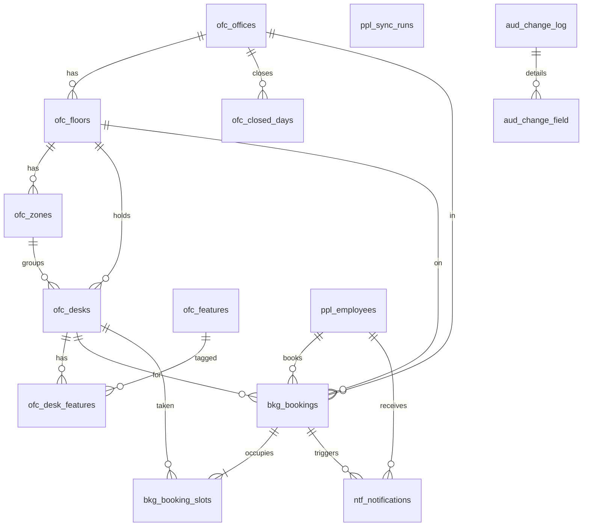

# Data model - DeskBook

Stage S5 (data-architect), 2026-10-28. Inputs: `05-architecture.md` (section 8.2, modules, ADR-2, 3, 5, 6, 10),
`02-spec.md`, `04-stories.md`, `decisions.md` D1-D4, `base/BASE-SPEC.md` B1.25 (Flyway), B6 (audit) and the
TTCommon tables note. Gate G3 reviews this file before any entity is written. No entity or migration code is written here.

Updated 2026-10-29 (S8 audit M7, data-architect): sections 1, 2, 4, 7, 8, 9, 12, 13 now match the real migrations V001-V062 in
`D:/products/desk-booking/Backend/src/main/resources/db/migration` (read-only check, every column compared). What the build
added or changed is listed in the new section "Changes during build" at the end; one planned change (V063, Q184) is marked planned.

Scope: full physical model for the MVP tables (section 4). R1 and R2 tables are listed with purpose only (section 5).

## 1. Design decisions

| # | Decision | Why |
|---|---|---|
| DM-1 | PostgreSQL, EclipseLink, Flyway `V0xx__name.sql` (B1.25). DDL is hand-written SQL in Flyway, entities are mapped to it; EclipseLink DDL generation stays off. | Base mechanism (B1.25). Partial and functional unique indexes (ADR-2) cannot be modelled by EclipseLink. |
| DM-2 | Keys: `id` UUID assigned in `@PrePersist` (B6.1), one choice for the whole product. | Base standard. Note for the base team: a time-ordered UUID (v7) would keep the 2 M-row booking index tighter than random v4; not blocking. |
| DM-3 | Tenant: row-level `tenant_id varchar(100)` (B6.1, set by the entity listener, never changes after insert). `tenant_id` is the first column of every unique key and every tenant index. One company per deployment today, so this is cheap insurance. | Standards: record row-level vs schema per tenant. Schema per tenant rejected: the base has one schema and TTCommon tables are row-tenanted. |
| DM-4 | Dates and times: office-local calendar date is a `date` (`booking_date`, `closed_on`, `bookable_from`, `retired_on`); release times are `time` (office-local); every instant (deadlines, check-in time, audit) is `timestamptz` stored as UTC (ADR-3). | ADR-3. |
| DM-5 | Reference values that code decides (status, part of day, deadline kind, office state, cancel reason, notification type) are `varchar` plus a named CHECK constraint, not lookup tables. Values admins edit (features, zones) are tables. | Enum values drive code paths; adding one is a migration plus a code change either way. A lookup table would add a join to every booking read for no gain. |
| DM-6 | Working days: seven boolean columns `works_mon` .. `works_sun` on `ofc_offices`, not a child table. | The set is the seven weekdays and never grows; the booking calendar reads it with the office row (one read, no join); a CHECK guarantees at least one day. Not JSON. Logged here as a deliberate de-normalisation of a repeating group; lead to copy into `decisions.md`. |
| DM-7 | `bkg_bookings` carries `office_id` and `floor_id` next to `desk_id` (de-normalised snapshot). | Report path (ADR-10): per office, floor and day, 3 months all offices under 5 s, must be a single-table grouped index scan, and must keep showing the floor where the person sat even if the desk is later changed. Floor of a booked desk is locked like its code (Q86). |
| DM-8 | Cross-module foreign keys ARE declared in the database (RESTRICT), although JPA relations do not cross modules (ADR-1: ids only in Java). | One schema; the database guards integrity at no cost. Entities hold plain `UUID` fields for cross-module references. |
| DM-9 | Soft delete columns (`deleted_at`, `deleted_by`) exist on every table (B6.1 `AuditableEntity`) but are used only where users can remove a row: zones, features, desk features, closed days. Offices, floors and desks are never deleted, only closed or retired (R2); bookings end in a status. | Standards: soft delete where users can delete; unique keys exclude deleted rows. |
| DM-10 | No JSON or CLOB columns anywhere. | Standards. |
| DM-11 | Company booking rules (horizon, hold minutes, late minutes) live in TTCommon `CONFIGURATION` group `DESKBOOK` (ADR-11): no DeskBook table. | ADR-11. |
| DM-12 | Exception to DM-6, accepted at build (Q175): `ofc_offices.prev_working_days varchar(60)` holds the earlier working days as comma separated DayOfWeek names, next to three `prev_*` time columns. | It is a snapshot of the office row, read only together with the office row, never filtered, joined or grouped in SQL, parsed in one place (`Office`), and a CHECK makes the four `prev_*` columns all null or all set. A normalised settings-history table would add a join to every booking-date rule for a value that exists once per office. Revisit only if R1 needs the history of settings (then a table `ofc_office_settings_history`, additive). |
| DM-13 | Migration numbers are global and ever increasing, not per module (Q148). | Flyway does not apply a number lower than the highest applied one (out of order is off). The module ranges in the first plan (V010-V013) were only a hint; the build used V010, V020, V030, V050, V060-V062 and the next free number is V063. A new script takes the next free number above the highest one in the folder. |

## 2. Conceptual model (objects, owner, lifecycle)

| Object | Owner module | Lifecycle | Who changes it |
|---|---|---|---|
| Office (with settings) | office | Draft -> Open -> Closed (never deleted) | admin |
| Floor | office | Active -> Retired (never deleted) | admin |
| Zone | office | Exists while desks use it, then deletable | admin |
| Desk | office | Active (from `bookable_from`) -> Retired (`retired_on`); code locked after first booking | admin |
| Feature, Desk-feature | office | Created, deleted while unused | admin |
| Closed day | office | Added, removed (future only) | admin |
| Employee (projection) | people | Upserted nightly; Active -> Left (then `leaver_handled_at` is set once the leaver hand-over ran); Left -> anonymised after retention | system |
| Sync run | people | RUNNING -> SUCCESS or FAILED (a crash leftover is closed as FAILED with `error_code` ABANDONED) | system |
| Booking | booking | BOOKED -> CHECKED_IN -> COMPLETED; BOOKED -> CANCELLED / NO_SHOW / RELEASED_AFTER_HOLD; anonymised after 2 years | employee, system |
| Booking slot | booking | Created with the booking, inactive when the booking ends | system (derived) |
| Notification (outbox + log) | notification | PENDING -> SENT, FAILED, SKIPPED (no usable address or inactive person) or EXPIRED (a reminder that lost its value); purged | system |

Relationships: Office 1-N Floor 1-N Zone; Floor 1-N Desk; Zone 1-N Desk; Desk N-M Feature (join table);
Office 1-N Closed day; Employee 1-N Booking (as employee) and 0-N as booker (R1); Desk, Floor, Office 1-N Booking;
Booking 1-1..2 Slot; Booking 0-N Notification; Employee 1-N Notification (recipient). Manager link is by SF user id
inside `ppl_employees` (no FK, see 4.6).

## 3. Diagram

`ppl_sync_runs` stands alone (a run log). `aud_*` belong to the base (B6.4) and refer to every audited table by
`entity_type` + `entity_id` with no foreign key, so history survives.

## 4. Physical model (MVP)

Naming: tables plural snake_case with prefix `ofc_` `ppl_` `bkg_` `ntf_`; indexes `ix_`, unique `uq_`, foreign
keys `fk_`, checks `ck_`. No quoted identifiers, no reserved words. Constraint names below are stable: the backend
maps `uq_bkg_booking_slots_desk_date_half` to `DESK_JUST_TAKEN` and `uq_bkg_bookings_employee_date` to
`ALREADY_BOOKED_THAT_DAY` (ADR-2; the base handler would answer `DUPLICATE`).

### 4.0 Standard columns (on every table below, from `AuditableEntity`, B6.1)

| Column | Type | Null | Default | Meaning |
|---|---|---|---|---|
| `id` | uuid | NN | assigned in `@PrePersist` | primary key |
| `tenant_id` | varchar(100) | NN | set by listener | tenant; first column of every unique key and tenant index; immutable |
| `created_at` | timestamptz | NN | set by listener | when created |
| `created_by` | varchar(100) | NN | set by listener | user id, or the job name inside a job |
| `updated_at` | timestamptz | NN | set by listener | last change |
| `updated_by` | varchar(100) | NN | set by listener | user id or job name |
| `version` | bigint | NN | 0 | optimistic locking (`@Version`); the `If-Match` value on the API |
| `deleted_at` | timestamptz | null | null | soft delete; used only where DM-9 says so, else always null |
| `deleted_by` | varchar(100) | null | null | who soft-deleted |

Coverage check: all 12 MVP business tables carry the nine columns: ofc_offices, ofc_floors, ofc_zones,
ofc_desks, ofc_features, ofc_desk_features, ofc_closed_days, ppl_employees, ppl_sync_runs, bkg_bookings,
bkg_booking_slots, ntf_notifications (the join table counted; none missing).
Tables below list only their own columns.

### 4.1 `ofc_offices` (module office)

| Column | Type | Null | Default | Meaning |
|---|---|---|---|---|
| `name` | varchar(120) | NN | | office name; unique ignoring case (R1) |
| `city` | varchar(100) | NN | | city |
| `timezone` | varchar(64) | NN | | IANA id (for example Asia/Kolkata), chosen from the list; validated in code (`INVALID_TIMEZONE`); editable only while no future bookings (ADR-3) |
| `state` | varchar(10) | NN | 'DRAFT' | DRAFT, OPEN, CLOSED |
| `opened_on` | date | null | | office-local date it first opened; null while DRAFT; capacity starts here |
| `closed_on` | date | null | | office-local date it closed; capacity ends here (see Q84) |
| `morning_release_time` | time | NN | '10:00' | local release time of full-day and morning bookings |
| `afternoon_release_time` | time | NN | '14:00' | local release time of afternoon bookings |
| `midday_split_time` | time | NN | '13:00' | local split between morning and afternoon (A10) |
| `works_mon` .. `works_sun` | boolean x7 | NN | true for Mon-Fri, false for Sat, Sun | working days (DM-6) |
| `settings_effective_from` | date | null | | office-local date from which the current times and working days apply (a settings change applies from the next office-local day, R10; Q140). Null until the first settings change. Dates before it are judged with the `prev_*` values (V010) |
| `prev_morning_release_time`, `prev_afternoon_release_time`, `prev_midday_split_time` | time x3 | null | | the times in force before the last settings change, so a same-day change cannot move today's deadlines (Q146, Q164, Q175). Null = no earlier times, use the current ones for every date (V062) |
| `prev_working_days` | varchar(60) | null | | the working days in force before the last change, comma separated DayOfWeek names such as `MONDAY,TUESDAY`; exception DM-12 (V062). A second change before the first took effect keeps the oldest values |
| `sf_location_code` | varchar(50) | null | | SuccessFactors location code that maps people's home office to this office (Q63) |

Keys and indexes: PK `id`. `uq_ofc_offices_name` (tenant_id, lower(name)) WHERE deleted_at IS NULL.
`uq_ofc_offices_sf_location` (tenant_id, sf_location_code) WHERE sf_location_code IS NOT NULL.
`ix_ofc_offices_tenant_state` (tenant_id, state) serves the office picker.
Checks: `ck_ofc_offices_state` state IN (DRAFT, OPEN, CLOSED); `ck_ofc_offices_release_order`
afternoon_release_time > morning_release_time AND afternoon_release_time >= midday_split_time (R11);
`ck_ofc_offices_one_workday` at least one `works_*` true; `ck_ofc_offices_closed` state <> 'CLOSED' OR closed_on IS NOT NULL; `ck_ofc_offices_prev_times` the four `prev_*` columns are all null or all set (V062).
CLOSED is final (Q139): there is no reopen, so `closed_on` is enough and no periods table is needed (answers the capacity part of Q84).
Audit: on, all columns except the four `prev_*` (`@NotAudited`: the audit trail already holds the real change). Soft delete: not used.

### 4.2 `ofc_floors`

| Column | Type | Null | Default | Meaning |
|---|---|---|---|---|
| `office_id` | uuid | NN | | FK `fk_ofc_floors_office` -> ofc_offices, RESTRICT |
| `name` | varchar(100) | NN | | floor name; unique within the office ignoring case |
| `retired_on` | date | null | | office-local date from which the floor and its desks are not bookable or capacity |

`uq_ofc_floors_office_name` (tenant_id, office_id, lower(name)) WHERE deleted_at IS NULL (also serves the FK lookup by office).
Retired floors keep their name (the name stays reserved). Audit: on.

### 4.3 `ofc_zones`

| Column | Type | Null | Default | Meaning |
|---|---|---|---|---|
| `floor_id` | uuid | NN | | FK `fk_ofc_zones_floor` -> ofc_floors, RESTRICT |
| `name` | varchar(100) | NN | | zone name; "Main" created with each floor (R5) |

`uq_ofc_zones_floor_name` (tenant_id, floor_id, lower(name)) WHERE deleted_at IS NULL.
`uq_ofc_zones_floor_id_id` (floor_id, id): target of the composite FK from desks, so a desk can never point to a zone of another floor.
Soft delete used (`deleteZone`, refused while desks use it). Audit: on.

### 4.4 `ofc_desks`

| Column | Type | Null | Default | Meaning |
|---|---|---|---|---|
| `floor_id` | uuid | NN | | FK `fk_ofc_desks_floor` -> ofc_floors, RESTRICT |
| `zone_id` | uuid | NN | | zone of the desk; composite FK `fk_ofc_desks_floor_zone` (floor_id, zone_id) -> ofc_zones (floor_id, id), RESTRICT |
| `code` | varchar(30) | NN | | printed desk code (for example BLR-3-14); unique across the tenant ignoring case; locked once the desk has a booking (R4) |
| `bookable_from` | date | NN | creation date + 1 (set by service) | first office-local date the desk can be booked and counts as capacity (AC2.1) |
| `retired_on` | date | null | | date from which the desk is retired; past capacity stays right (R40, AC2.9) |

`uq_ofc_desks_code` (tenant_id, lower(code)) WHERE deleted_at IS NULL (retired desks keep their code: it is printed).
`ix_ofc_desks_floor_code` (tenant_id, floor_id, code): desk list per floor, free-desk query, capacity.
`ix_ofc_desks_zone` (zone_id): "zone in use" check.
Check `ck_ofc_desks_dates` retired_on IS NULL OR retired_on >= bookable_from.
Office of a desk = its floor's office (3NF); the booking snapshots it (DM-7). The R1 columns `reserved` (accessibility) and the block table come in R1 (section 5). Audit: on.

### 4.5 `ofc_features`, `ofc_desk_features`, `ofc_closed_days`

`ofc_features`: `name varchar(60) NN`. `uq_ofc_features_name` (tenant_id, lower(name)) WHERE deleted_at IS NULL. Soft delete used (refused while desks use it). Audit: on.

`ofc_desk_features` (join, own key and audit columns):

| Column | Type | Null | Meaning |
|---|---|---|---|
| `desk_id` | uuid NN | FK `fk_ofc_desk_features_desk` -> ofc_desks, RESTRICT |
| `feature_id` | uuid NN | FK `fk_ofc_desk_features_feature` -> ofc_features, RESTRICT |

`uq_ofc_desk_features_desk_feature` (desk_id, feature_id) WHERE deleted_at IS NULL; `ix_ofc_desk_features_feature` (feature_id). Removing a feature from a desk soft-deletes the row. Audit: on (feature changes appear in the desk history).

`ofc_closed_days`:

| Column | Type | Null | Meaning |
|---|---|---|---|
| `office_id` | uuid NN | FK `fk_ofc_closed_days_office` -> ofc_offices, RESTRICT |
| `closed_on` | date NN | office-local date; not in the past when added |
| `reason` | varchar(200) null | holiday name; no personal data. 200 as built (V010) and in the API contract (Q141); was 100 in the first design |

`uq_ofc_closed_days_office_date` (tenant_id, office_id, closed_on) WHERE deleted_at IS NULL (also serves range reads per office). Soft delete used (`removeClosedDay`). Audit: on.

### 4.6 `ppl_employees` (module people, ADR-6)

| Column | Type | Null | Default | Meaning |
|---|---|---|---|---|
| `user_id` | varchar(100) | NN | | SuccessFactors user id = sign-in user id (Q62); how the session finds the employee |
| `full_name` | varchar(200) | null | | personal data; null only once anonymised |
| `email` | varchar(254) | null | | personal data; null only once anonymised; records without email are skipped by the sync (AC14.7) |
| `manager_user_id` | varchar(100) | null | | SF user id of the direct manager. Deliberately no FK: the manager's record can arrive later in the paged read or be absent (skipped, no email); team queries join on `user_id` |
| `home_office_code` | varchar(50) | null | | SF location code; mapped to an office through `ofc_offices.sf_location_code` at read time |
| `sf_person_id` | varchar(100) | null | | SF `personIdExternal` (Q110, 05-sf-fields 5). Personal data (an identifier). Null for a tenant without Employee Central. Never a key and not unique: concurrent employment or a rehire gives two rows (two `user_id`) with one person id, so R2 anonymisation can treat them as one person |
| `is_manager` | boolean | NN | false | derived after each run (R52): manager of at least one active employee. De-normalised because every request needs it for the menu and route guards (`getMyProfile`), rebuilt by the job each run |
| `active` | boolean | NN | true | false after the person left (R51) |
| `source` | varchar(10) | NN | 'SF' | SF (MVP); MANUAL from R1 `addPerson` (Q60) |
| `left_at` | timestamptz | null | | when the sync first saw her inactive or missing; starts the retention clock |
| `last_synced_at` | timestamptz | NN | | last run that CHANGED this record (as built, Q171): a second run must not touch unchanged rows, so it is not "last seen". "Last seen" is the `finished_at` of the last SUCCESS run in `ppl_sync_runs`. Name kept (a rename is a migration for no gain) |
| `anonymised_at` | timestamptz | null | | set when name and email were removed |
| `leaver_handled_at` | timestamptz | null | | the leaver hand-over marker (V050, ST-PP-3): set when the `EmployeeLeft` event of this person was handled (future bookings cancelled); null on an inactive row with `left_at` set means "still to do", so the catch-up of the next run picks it up. Cleared when the person comes back. No personal data; audited |

Keys and indexes: `uq_ppl_employees_user` (tenant_id, user_id). `ix_ppl_employees_email` (tenant_id, lower(email)) (R1 manual match). `ix_ppl_employees_manager` (tenant_id, manager_user_id) (reports of a manager, R1 team week, `is_manager` derivation). `ix_ppl_employees_sf_person` (tenant_id, sf_person_id) non-unique (all rows of one person for anonymisation, the R1 email-match check).
Checks: `ck_ppl_employees_source` IN (SF, MANUAL); `ck_ppl_employees_anonymised` (full_name IS NOT NULL AND email IS NOT NULL) OR anonymised_at IS NOT NULL.
Rows are never deleted (bookings reference them, RESTRICT); leavers are anonymised in place. Audit: on, `full_name`, `email` and `sf_person_id` `@AuditMasked` (old and new stored as `***`); the nightly job's changes appear with `updated_by` = job name. R1 note: manual records may exist before the person's first sign-in, so `user_id` becomes nullable with a partial unique then (additive, Q60).

### 4.7 `ppl_sync_runs`

| Column | Type | Null | Default | Meaning |
|---|---|---|---|---|
| `run_date` | date | NN | | UTC day of the run; with status SUCCESS answers "already succeeded today" |
| `started_at` | timestamptz | NN | | |
| `finished_at` | timestamptz | null | | null while RUNNING |
| `status` | varchar(10) | NN | 'RUNNING' | RUNNING, SUCCESS, FAILED |
| `trigger_type` | varchar(10) | NN | 'SCHEDULED' | SCHEDULED; MANUAL in R1 (`runSyncNow`) |
| `read_count`, `new_count`, `changed_count`, `left_count`, `skipped_no_email_count` | integer x5 | NN | 0 | counts shown to the admin (AC14.1, AC14.7) |
| `inactive_count`, `missing_count` | integer x2 | NN | 0 | `inactive_count`: people newly `f` in this run (marked inactive, leaver not yet handled). `missing_count`: active copies absent from the read (counted only, nothing changed; M8, 05-integrations 1.3, 1.6). Next to `left_count` (leavers handled in this run), so the admin can tell real leavers from vanished rows; both feed the 10 percent sanity check |
| `error_code` | varchar(60) | null | | failure class; never a message with person data |

`uq_ppl_sync_runs_one_running` (tenant_id) WHERE status = 'RUNNING': at most one running sync (AC14.8).
`ix_ppl_sync_runs_status_finished` (tenant_id, status, finished_at DESC): last good copy date (R49), banner after 2 days.
Checks: status and trigger values. Audit: opt-out, reason "system-written run log, it is itself the history". Purge rows older than 400 days (section 9).
As built (Q171): the status check has no ABANDONED; a run left RUNNING by a crash is closed as FAILED with `error_code` ABANDONED (no schema change). The skipped list (user id and reason) and the unchanged and bad-email counts are only in the job result text in the MVP. Decided for R1 (S18 sync tab): a child table `ppl_sync_issues` (section 5; run id FK, user id, reason code, at most 500 rows per run, no names) plus two additive integer columns `unchanged_count` and `bad_email_count` on `ppl_sync_runs` in the same R1 script. No JSON column (DM-10).

### 4.8 `bkg_bookings` (module booking, the big table)

| Column | Type | Null | Default | Meaning |
|---|---|---|---|---|
| `employee_id` | uuid | null | | FK `fk_bkg_bookings_employee` -> ppl_employees, RESTRICT. Null only after anonymisation (R2) |
| `booked_by` | varchar(10) | NN | 'SELF' | SELF; MANAGER from R1 |
| `booked_by_employee_id` | uuid | null | | FK `fk_bkg_bookings_booker` -> ppl_employees, RESTRICT; set when MANAGER |
| `group_id` | uuid | null | | R2 group booking correlation id; no table, no FK |
| `office_id` | uuid | NN | | FK `fk_bkg_bookings_office` -> ofc_offices, RESTRICT (snapshot, DM-7) |
| `floor_id` | uuid | NN | | FK `fk_bkg_bookings_floor` -> ofc_floors, RESTRICT (snapshot) |
| `desk_id` | uuid | NN | | FK `fk_bkg_bookings_desk` -> ofc_desks, RESTRICT |
| `booking_date` | date | NN | | office-local date (ADR-3) |
| `part` | varchar(10) | NN | | FULL_DAY, MORNING, AFTERNOON |
| `status` | varchar(20) | NN | 'BOOKED' | BOOKED, CHECKED_IN, COMPLETED, NO_SHOW, RELEASED_AFTER_HOLD, CANCELLED |
| `cancel_reason` | varchar(20) | null | | only when CANCELLED: USER, MANAGER, ADMIN, LEAVER, OFFICE_CLOSED, FLOOR_RETIRED, DESK_RETIRED, DESK_BLOCKED, CLOSED_DAY |
| `check_in_deadline` | timestamptz | NN | | UTC instant, computed by OfficeClock (ADR-3) |
| `original_deadline` | timestamptz | NN | | deadline before any hold; used by reports (cancelled before the release time, R41) |
| `deadline_kind` | varchar(10) | NN | | NORMAL, LATE (booked after release, +30 min), HOLD (after "Running late") |
| `hold_used_at` | timestamptz | null | | set once by `holdBooking` (CI-7) |
| `checked_in_at` | timestamptz | null | | |
| `released_at` | timestamptz | null | | job time; release lag = released_at - check_in_deadline (6.6) |
| `cancelled_at` | timestamptz | null | | |
| `idempotency_key` | varchar(80) | null | | `Idempotency-Key` of `createBooking` (AC5.4), or `<key>:<date>` per day of `createBookings` (ADR-12); replay returns this row. Header max 64 + `:` + 10-char date = 75, fits in 80 (was 64: widened, nothing deployed) |
| `anonymised_at` | timestamptz | null | | R2 |

Unique keys: `uq_bkg_bookings_employee_date` (tenant_id, employee_id, booking_date) WHERE status IN ('BOOKED','CHECKED_IN') (R17, ADR-2). `uq_bkg_bookings_idempotency` (tenant_id, employee_id, idempotency_key) WHERE idempotency_key IS NOT NULL.
Indexes:
- `ix_bkg_bookings_employee_date` (tenant_id, employee_id, booking_date) INCLUDE (desk_id, office_id, status): My bookings, Today, leaver cancellation, and the usual-desk query (index-only: most booked desk of the person in the last 60 days, at least 3 bookings, status BOOKED/CHECKED_IN/COMPLETED; spec G25, Q97).
- `ix_bkg_bookings_booked_deadline` (tenant_id, check_in_deadline) WHERE status = 'BOOKED': release job and reminder job. Partial: it holds only open bookings (about 20,000 rows), so it stays tiny while the table grows.
- `ix_bkg_bookings_office_date` (tenant_id, office_id, booking_date) INCLUDE (floor_id, desk_id, part, status, original_deadline, cancelled_at): report scan and occupancy grid (index-only; the grid groups by the desk's current zone, so it needs `desk_id`), settings-change recompute, future-bookings check per office.
- `ix_bkg_bookings_floor_date` (tenant_id, floor_id, booking_date): floor retire check (also the FK index).
- `ix_bkg_bookings_desk_date` (tenant_id, desk_id, booking_date): "desk has bookings" (code lock, retire check) and FK index.
- `ix_bkg_bookings_booker` (booked_by_employee_id) WHERE booked_by_employee_id IS NOT NULL: FK index (R1).
Checks: `ck_bkg_bookings_status`, `_part`, `_deadline_kind`, `_booked_by` (values); `ck_bkg_bookings_cancel` (status = 'CANCELLED') = (cancel_reason IS NOT NULL); `ck_bkg_bookings_checked_in` status NOT IN ('CHECKED_IN','COMPLETED') OR checked_in_at IS NOT NULL; `ck_bkg_bookings_employee` employee_id IS NOT NULL OR anonymised_at IS NOT NULL; `ck_bkg_bookings_booker` booked_by = 'MANAGER' OR booked_by_employee_id IS NULL.
Planned index change (Q184, PB-5 of 07-performance, migration V063, NOT yet built): every repository query adds `deleted_at IS NULL`, and `deleted_at` is in none of the indexes above, so the "index-only" reads are heap fetches (about 17,000 rows for `proposeDesks` at 14 days, 150,000-600,000 for the 3-month report). V063 drops and recreates three indexes as partial with `WHERE deleted_at IS NULL` and the same columns and INCLUDE lists: `ix_bkg_bookings_office_date`, `ix_bkg_bookings_employee_date`, and `ix_bkg_bookings_booked_deadline` (predicate `status = 'BOOKED' AND deleted_at IS NULL`). Bookings are never soft-deleted (DM-9), so the predicate excludes nothing today and costs nothing; it only lets the planner match the query. The two unique indexes already exclude by status or key and stay as they are. Needs (Q212): the release and reminder queries must carry the status as a literal, not a bind value, or the planner cannot match the partial predicate in a generic plan.
Audit: on, with `@NotAudited` on derived or technical columns (section 8) and `@AuditMasked` on `employee_id`, `booked_by_employee_id`. Soft delete: not used (status ends the life).

### 4.9 `bkg_booking_slots` (ADR-2)

| Column | Type | Null | Default | Meaning |
|---|---|---|---|---|
| `booking_id` | uuid | NN | | FK `fk_bkg_booking_slots_booking` -> bkg_bookings, CASCADE: a slot has no meaning without its booking, and bookings are never hard-deleted by the app, so cascade only matters for a future retention purge |
| `desk_id` | uuid | NN | | FK `fk_bkg_booking_slots_desk` -> ofc_desks, RESTRICT |
| `booking_date` | date | NN | | copy of the booking date (needed in the unique index) |
| `half` | varchar(9) | NN | | MORNING or AFTERNOON; a FULL_DAY booking has two rows |
| `active` | boolean | NN | true | false once the booking is cancelled, released or completed; set in the same transaction as the status |

`uq_bkg_booking_slots_desk_date_half` (tenant_id, desk_id, booking_date, half) WHERE active: first request wins; also the anti-join index of the free-desk query and the "future bookings on a desk" check.
`ix_bkg_booking_slots_booking` (booking_id): FK index, deactivate by booking.
Check `ck_bkg_booking_slots_half`. Audit: opt-out, reason "derived from the booking and rewritten with it; the booking carries the history" (ADR-2).
Rule outside the database: slot `active` mirrors status BOOKED or CHECKED_IN; covered by a PostgreSQL integration test.

### 4.10 `ntf_notifications` (module notification, ADR-5: outbox and log)

| Column | Type | Null | Default | Meaning |
|---|---|---|---|---|
| `event_key` | varchar(150) | NN | | idempotency key, e.g. `RELEASED:<bookingId>`, `PRE_RELEASE:<bookingId>:<deadline epoch>` |
| `notification_type` | varchar(30) | NN | | PRE_RELEASE, RELEASED (MVP); R1 types added by migration |
| `recipient_employee_id` | uuid | NN | | FK `fk_ntf_notifications_recipient` -> ppl_employees, RESTRICT; the address is read from `ppl_employees` at send time, never copied |
| `booking_id` | uuid | null | | FK `fk_ntf_notifications_booking` -> bkg_bookings, RESTRICT; context for the template |
| `status` | varchar(10) | NN | 'PENDING' | PENDING, SENT, FAILED, SKIPPED, EXPIRED. As built (V061, Q174): SKIPPED = no usable address or the person is inactive (05-integrations 2.3); EXPIRED = a PRE_RELEASE reminder that ran out of time (Q78); the first design had only the first three |
| `attempts` | smallint | NN | 0 | 0-3 (check `ck_ntf_notifications_attempts`) |
| `next_attempt_at` | timestamptz | NN | set by code (no SQL default) | PENDING rows due at or before now are sent; the retry times are a code rule (Q179 owns the as-built values: +2 and +5 minutes, expiry), not part of the schema |
| `sent_at` | timestamptz | null | | |
| `last_error_code` | varchar(60) | null | | error class only |

`uq_ntf_notifications_event` (tenant_id, event_key): exactly once per event (AC13.7).
`ix_ntf_notifications_due` (tenant_id, next_attempt_at) WHERE status = 'PENDING': dispatch job.
`ix_ntf_notifications_status_created` (tenant_id, status, created_at): purge and the R1 log page.
`ix_ntf_notifications_recipient` (recipient_employee_id), `ix_ntf_notifications_booking` (booking_id) WHERE booking_id IS NOT NULL: FK indexes.
Checks: `ck_ntf_notifications_status` (5 values), `ck_ntf_notifications_type` (PRE_RELEASE, RELEASED), `ck_ntf_notifications_attempts` 0-3. Audit: opt-out, reason "the table is the delivery log itself". No message text, no email address stored.
Event keys as built: `PRE_RELEASE:<bookingId>:<deadlineEpoch>` (a moved deadline gives one new reminder) and `RELEASED:<bookingId>`. `ix_ntf_notifications_due` is partial, so the H2 test schema skips it (`H2SchemaTest` pins that). Purge (as built): SENT, SKIPPED and EXPIRED rows after 90 days, FAILED after 180.

## 5. R1 / R2 tables (purpose only)

| Table | Release | Purpose |
|---|---|---|
| `ofc_desk_blocks` | R1 | Desk blocked for a date range (maintenance); capacity and free-desk query subtract it. |
| `ofc_desks.reserved` (column) | R1 | Reserved-for-accessibility flag. Additive column, default false. |
| `acc_access_entries` | R1 | Admin-kept list of employees who may see reserved desks. Names only, no reason (R54). |
| `tm_manager_delegates` | R1 | One delegate per manager acting for the team week and booking (Q58). |
| `ppl_sync_issues` | R1 | Records skipped by a sync run (no email) with a reason code, listed on the sync status page (AC14.7); MVP keeps the count only. |
| `rpt_search_log` | R1 | One row per free-desk search: office, day, part, zone, number found, time; no person (Q59). Partitioned by month, 2-year retention. |
| `bkg_bookings` new columns | R1/R2 | none beyond those above; `AnonymiseJob` (R2) fills `employee_id` null, `anonymised_at`. |

## 6. Relationships and delete rules

| FK | Rule | Why |
|---|---|---|
| floors -> offices; zones -> floors; desks -> floors; desks (floor, zone) -> zones; desk_features -> desks and features; closed_days -> offices | RESTRICT | Nothing under an office or floor is hard-deleted; the application retires or soft-deletes, and RESTRICT is the safety net. |
| bookings -> employees, booker, offices, floors, desks | RESTRICT | A booking is history (reports, 2-year retention); anonymise instead of delete. |
| booking_slots -> bookings | CASCADE | Owned child, meaningless alone. |
| booking_slots -> desks | RESTRICT | As above. |
| notifications -> employees, bookings | RESTRICT | Purged by their own job (90 days), never by cascade. |
| no FK: employees.manager_user_id, aud_* -> business tables | - | See 4.6 and B6.4. |

## 7. Queries and indexes

| # | Query (operation) | Index used |
|---|---|---|
| 1 | Open offices for the picker (`listBookableOffices`) | `ix_ofc_offices_tenant_state` |
| 2 | Free desks for office, date, half, paged 50 with `totalFree` (`listFreeDesks`): floors of the office, desks of those floors with `bookable_from <= date`, not retired, NOT EXISTS active slot | `uq_ofc_floors_office_name`, `ix_ofc_desks_floor_code`, `uq_bkg_booking_slots_desk_date_half` (index-only anti-join); features by `uq_ofc_desk_features_desk_feature` batched, no N+1 |
| 3 | Calendar of bookable dates (`getBookingCalendar`): office row (working days, times) + closed days in the horizon | PK; `uq_ofc_closed_days_office_date` |
| 4 | Create booking (`createBooking`): employee by user id, insert booking and slots, idempotency replay | `uq_ppl_employees_user`, `uq_bkg_bookings_employee_date`, `uq_bkg_booking_slots_desk_date_half`, `uq_bkg_bookings_idempotency` |
| 5 | My bookings, upcoming plus 30 days, paged; Today (`listMyBookings`, `getToday`) | `ix_bkg_bookings_employee_date` |
| 6 | Release due bookings, batch 200 oldest first (`ReleaseBookingsJob`); reminders in the window before the deadline (lead 15 minutes, `PreReleaseReminderJob`) | `ix_bkg_bookings_booked_deadline` (partial on status; the status must be a literal in the query, Q212) |
| 7 | Recompute deadlines after a settings change: BOOKED bookings of an office dated tomorrow or later | `ix_bkg_bookings_office_date` |
| 8 | Future bookings on a desk, floor, office, day (`BookingImpactPort`); desk code lock | desk: `uq_bkg_booking_slots_desk_date_half` and `ix_bkg_bookings_desk_date`; floor: `ix_bkg_bookings_floor_date`; office: `ix_bkg_bookings_office_date` |
| 9 | Occupancy report: group by office, floor, date over 3 months, plus capacity from desks and closed days (`getOccupancyReport`) | `ix_bkg_bookings_office_date` (index-only via INCLUDE); `ix_ofc_desks_floor_code`; `uq_ofc_closed_days_office_date` |
| 10 | Leaver: cancel future bookings of an employee | `ix_bkg_bookings_employee_date` |
| 11 | Profile and manager status (`getMyProfile`); reports of a manager (R1) | `uq_ppl_employees_user`; `ix_ppl_employees_manager` |
| 12 | Last good people copy, one RUNNING run | `ix_ppl_sync_runs_status_finished`, `uq_ppl_sync_runs_one_running` |
| 13 | Dispatch due notifications; purge | `ix_ntf_notifications_due`; `ix_ntf_notifications_status_created` |
| 14 | Admin lists (offices, floors, desks by floor, features), paged max 100 | office/floor unique indexes; `ix_ofc_desks_floor_code` (code search is a scan of at most ~4,000 desks per tenant, acceptable) |
| 15 | History of an office or desk (`GET .../history`) | base `ix_aud_change_log_tenant_entity` |
| 16 | Usual desk (`proposeDesks`, `getToday`): own bookings in the office, last 60 days, group by desk, count >= 3, ties most recent | `ix_bkg_bookings_employee_date` (index-only via INCLUDE `desk_id`, `office_id`, `status`); at most ~60 rows per person |
| 17 | Occupancy grid, zones x days (`getOccupancyGrid`): bookings of an office per day grouped by the desk's current zone | `ix_bkg_bookings_office_date` (index-only via INCLUDE `desk_id`) joined to `ofc_desks.zone_id` by PK |
| 18 | Batch create (`createBookings`), 1-14 days: per day the same path as query 4, idempotency per day | `uq_bkg_bookings_idempotency` (key `<key>:<date>`) |

No `SELECT *` on `bkg_bookings`: list queries use projections (DTO constructor queries) and join-fetch only desk and floor
names for the page being returned (one query per page).

## 8. Audit

Every MVP business table is covered by the generic change history (B6) except the opt-outs below, each with a reason.

| Table | Audit | Reason / note |
|---|---|---|
| ofc_offices, floors, zones, desks, features, desk_features, closed_days | on, all columns (offices: except the four `prev_*` columns, `@NotAudited`) | admin history panels (OS-1, OS-5); the `prev_*` values are a technical copy of what the audited change already shows |
| ppl_employees | on, `full_name`, `email` and `sf_person_id` masked | personal data; not shown in history. `leaver_handled_at` is audited |
| bkg_bookings | on, trimmed | `@NotAudited` as built (10): `group_id`, `office_id`, `floor_id`, `check_in_deadline`, `original_deadline`, `idempotency_key`, `checked_in_at`, `released_at`, `cancelled_at`, `anonymised_at` (each is implied by a status change that IS audited, or derived or technical; `group_id` and `anonymised_at` were added at build, accepted). `@AuditMasked`: `employee_id`, `booked_by_employee_id`. Audited: desk, date, part, status, cancel reason, deadline kind, hold. About 8 fields on create and 2-3 per later change instead of 20+. |
| bkg_booking_slots | opt-out | derived from the booking (ADR-2) |
| ntf_notifications | opt-out | is the delivery log itself (ADR-5) |
| ppl_sync_runs | opt-out | is a run log |

Retention: set `AUDIT_RETENTION_MONTHS` to 24 for DeskBook (spec: history kept 2 years; base default is 84; Q87).

## 9. Volume and growth

Basis: 3,000 employees, about 450,000 bookings a year (A13), 1.5 slots per booking, 2 outbox rows per booking,
3 change-log rows per booking, go-live with a pilot office (Q55), so month 1 is a fraction of the yearly rate.

| Table | Go-live | 1 year | 5 years | Growth per working day | Row size | Note |
|---|---|---|---|---|---|---|
| ofc_offices | 1-4 | 8 | 12 | 0 | 300 B | |
| ofc_floors | 3-12 | 30 | 50 | 0 | 150 B | |
| ofc_zones | 5-30 | 80 | 150 | 0 | 150 B | |
| ofc_desks | 400-1,500 | 3,000 | 4,000 | ~0 | 200 B | |
| ofc_features / desk_features | 8 / 3,500 | 15 / 7,500 | 20 / 10,000 | ~0 | 100 B | |
| ofc_closed_days | 40 | 200 | 700 | ~0 | 150 B | soft-deleted rows stay |
| ppl_employees | 3,000 | 3,500 | 5,500 | ~3 | 400 B | leavers anonymised in place, never removed |
| ppl_sync_runs | 0 | ~400 | ~400 steady | 1-24 | 120 B | purge older than 400 days |
| bkg_bookings | 0 (month 1: ~40,000) | 450,000 | 2.25 M | ~1,800 | 300 B | stays under 10 M: no partitioning (see below) |
| bkg_booking_slots | 0 | 675,000 | live ~100,000 | ~2,700 | 120 B | hard-purge slots of bookings older than 90 days (nothing reads them) |
| ntf_notifications | 0 | 900,000 written | live ~225,000 | ~3,600 | 200 B | purge 90 days for SENT, SKIPPED and EXPIRED (FAILED rows 180 days) |
| aud_change_log (base) | few | 1.35 M written | live ~2.7 M (24 months) | ~5,400 | 150 B | monthly partitions, base job drops old ones |
| aud_change_field (base) | few | ~5 M written | live ~10 M (24 months) | ~20,000 | 250 B | biggest table; trimmed booking audit (section 8) keeps it here |
| rpt_search_log (R1) | 0 | 2 M | live ~4 M | ~8,000 | 100 B | partition by month, drop after 24 months (Q59) |

Partitioning and archiving: audit tables are already partitioned by month (B6.4). `bkg_bookings` reaches about 2.25 M rows in
5 years (about 0.7 GB with indexes), far below the 10 M mark, so no partitioning now; the hot indexes are partial or lead with
`tenant_id` plus a date, so a 5-year-old row costs no query time. Re-evaluate at 10 M rows: partition by `booking_date` (yearly).
Archiving is anonymisation (R2), not moving rows. Purges run as three daily jobs, one per owning module, in batches of 1,000 per transaction (Q83, Q88), never in request threads: `BookingSlotPurgeJob` (booking: slots of booking dates older than 90 days), `NotificationPurgeJob` (notification: SENT, SKIPPED, EXPIRED 90 days, FAILED 180 days), `SyncRunPurgeJob` (people: runs older than 400 days, never the last good run). No new table or row size change from the plan-my-week option; index entries on `bkg_bookings` grow by about 12-20 B for the two widened indexes (about +10 MB a year). Every list is paged; imports and sync run in background jobs.

## 10. Tenant isolation

Row-level `tenant_id` on every table, first in every unique key and tenant index, set and frozen by `AuditableEntityListener`
(B6.2). Every repository query filters by tenant through the entity listener/base repository pattern; a test per module reads
with a second tenant id and expects nothing. Audit reads apply the same 404 for another tenant (B6.9). The deployment is one
company today, so there is no second tenant to protect against; the isolation protects the later multi-company case.

## 11. Personal data

| Column | Purpose | Retention | Deletion / anonymisation |
|---|---|---|---|
| `ppl_employees.full_name`, `.email` | show names ("Booked by"), send email | while active; leavers 2 years after `left_at` (Q85) | set to null and `anonymised_at` filled by the R2 `AnonymiseJob`; audit values never stored (masked) |
| `ppl_employees.user_id`, `.manager_user_id`, `.home_office_code`, `.sf_person_id` | identity, team, home office, one person across several rows (Q110) | same | `user_id` and manager id replaced by a hash/placeholder at anonymisation (decide with security-architect, Q85); `sf_person_id` set to null |
| `bkg_bookings.employee_id`, `.booked_by_employee_id` | whose booking | 2 years after `booking_date` (spec) | set to null, `anonymised_at` filled; counts and desk-days stay (AC12.13); `idempotency_key` nulled too |
| `ntf_notifications.recipient_employee_id` | who gets the mail | 90 days (FAILED 180) | row purged |
| `*.created_by`, `*.updated_by` (user ids) | accountability | with the row | no names; covered by the same anonymisation of the employee |
| `aud_change_field` | history | 24 months | partition drop; masked values never held personal text |
No health data, no free-text reason fields, no names or emails in logs.

## 12. Migration plan

Mechanism: Flyway `V<NNN>__name.sql` (B1.25), run at application start, forward-only with a written rollback note per script.
DeskBook range starts at V010 (V001-V009 belong to the base).

| Order | Script (as built) | Contents | Rollback note |
|---|---|---|---|
| 0 | `V001` to `V004` (base) | baseline, `aud_change_log` and `aud_change_field` (monthly partitions), `thm_tenant_themes`, demo `prj_projects` and `prj_tasks` | base; see V060 for the demo tables |
| 1 | `V010__office_tables.sql` | ofc_offices (with `settings_effective_from`, reason 200), floors, zones, desks, features, desk_features, closed_days with all indexes and checks | before go-live: drop tables in reverse order; after: additive changes only |
| 2 | `V020__people_tables.sql` | ppl_employees (with `sf_person_id`), ppl_sync_runs (with `inactive_count`, `missing_count`); was planned as V011 (Q148) | same |
| 3 | `V030__booking_tables.sql` | bkg_bookings, bkg_booking_slots (partial and functional unique indexes, INCLUDE indexes, checks); needs 1 and 2; was planned as V012 | drop slots, then bookings; never after bookings exist without a data export |
| 4 | `V050__people_leaver_handled.sql` | `ppl_employees.leaver_handled_at timestamptz` null (leaver marker, ST-PP-3) | drop the column |
| 5 | `V060__drop_demo_module.sql` | `DROP TABLE IF EXISTS prj_tasks, prj_projects`. V004 stays in the folder (Q173, accepted: a database that applied it would refuse to start if the file were deleted); a fresh database creates and drops them. Audit rows of type PROJECT and TASK age out with the 24-month audit retention | none needed (demo data) |
| 6 | `V061__notification_tables.sql` | ntf_notifications as built (statuses incl. SKIPPED, EXPIRED); needs 2 and 3; was planned as V013 | before go-live drop the table; after: additive only |
| 7 | `V062__office_previous_times.sql` | four nullable `prev_*` columns and `ck_ofc_offices_prev_times` on ofc_offices | drop the check and the four columns |
| 8 | `V063__booking_partial_indexes.sql` (PLANNED, Q184, Q212) | drop and recreate `ix_bkg_bookings_office_date`, `ix_bkg_bookings_employee_date`, `ix_bkg_bookings_booked_deadline` as partial (4.8) | recreate the three old indexes; no data change |

Numbering rule: DM-13. The first plan (V010-V013, EN-1 delete V004) was replaced by the numbers above; section "Changes during build" says why each differs.

Backfill: none for the MVP (greenfield tables). Seed: default `CONFIGURATION` rows for group DESKBOOK (horizon 14, hold 90, late
30) are written by code on first read (ADR-11), not by SQL. `AUDIT_RETENTION_MONTHS` is set to 24 in configuration.
Deploy order: database migration first (same deploy, runs when the WAR starts, before requests are served), then the backend;
the SPA last. V063 builds three indexes on a table that is small at go-live (month 1 about 40,000 rows), so the plain `CREATE INDEX` inside Flyway's transaction is fine; if it is ever run on a large live table, build the new index first with `CREATE INDEX CONCURRENTLY` outside Flyway and drop the old one afterwards. R1 changes follow expand-then-contract: add nullable or defaulted columns and new tables first, backfill, then
tighten constraints in a later script, so a rolled-back backend still runs on the newer schema. Constraint names in section 4
are part of the code contract; a PostgreSQL integration test (not mocks) covers the two unique violations.

## 13. Self-check

- Every spec object has a home: Office, Floor, Zone, Desk, Feature, Closed day, Employee, Sync run, Booking (+ slots), Notification in section 4; Block, Access list entry, Search log, Delegate, Sync issues in section 5; Settings in `ofc_offices` and ConfigService.
- Every MVP operation in the architecture reads or writes existing tables: office operations -> `ofc_*`; `getBookingRules` -> CONFIGURATION; `getMyProfile` -> `ppl_employees`; `getToday` and booking operations -> `bkg_*`, `ofc_*`, `ppl_*`; `getOccupancyReport` -> `bkg_bookings`, `ofc_desks`, `ofc_floors`, `ofc_offices`, `ofc_closed_days`; jobs -> `bkg_bookings`, `ntf_notifications`, `ppl_*`. `05-openapi.yaml` was not yet written when this was checked: re-check when it exists.
- No table without tenant and audit columns (section 4.0); five tables are audit opt-outs or trimmed, each with a reason. Re-checked against V010-V062 on 2026-10-29: all 12 product tables carry the nine standard columns; base tables `aud_change_log`, `aud_change_field` and `thm_tenant_themes` (V002, V003) are outside this model (base B6, B7).
- Built-vs-design check (S8 M7): every column of V010, V020, V030, V050, V061, V062 is in section 4; every deviation is in "Changes during build" with a verdict.

## 14. Open questions (also in `questions.md`)

- Q84 Can a closed office be reopened? (decides `closed_on` vs a periods table for capacity.) As built CLOSED is final (Q139), so `closed_on` stands.
- Q85 When are leavers anonymised and how are `user_id` and manager ids treated?
- Q86 May the floor or zone of a desk change after its first booking?
- Q87 Audit retention 24 months and the trimmed booking audit fields.
- Q88 (answered) Three daily purge jobs, one per module; V004 deleted.

## Changes after GP (prototype option A, plan my week; ADR-12, Q83, Q88)

- No new table, no new migration script (planned V010-V013; as built V010, V020, V030, V061, see "Changes during build"; the V004 deletion was replaced by V060, Q173).
- `ix_bkg_bookings_employee_date` gets INCLUDE (desk_id, office_id, status) for the usual-desk query (most booked desk in 60 days, at least 3, Q97). `status` was added to the two columns the architect named, so the count ignores cancelled bookings and stays index-only.
- `ix_bkg_bookings_office_date` gets `desk_id` in its INCLUDE for the occupancy grid (zone is read from the desk's current zone).
- `idempotency_key` widened from varchar(64) to varchar(80): batch keys are `<key>:<date>` (64 + 1 + 10 = 75). Unique index `uq_bkg_bookings_idempotency` is unchanged.
- Three daily purge jobs (booking, notification, people) replace the single idea of one cross-module job (section 9). Queries 16-18 added to section 7.
- Integration-engineer handover (Q110, M8): `ppl_employees.sf_person_id` varchar(100) null, non-unique index `ix_ppl_employees_sf_person` (tenant_id, sf_person_id), audit-masked, nulled at anonymisation; `ppl_sync_runs.inactive_count` and `missing_count` integer NN default 0. Both went into the greenfield people script (built as `V020__people_tables.sql`, not V011; Q148).

## Changes during build (S8 audit M7, checked against V010-V062)

Every script below was read and compared column by column with sections 4.1-4.10. Verdict: A = accepted, the model above now shows it;
P = planned, not built; Q = question to the backend-developer.

| Script | What it did | Differs from the first design | Verdict |
|---|---|---|---|
| `V010__office_tables.sql` | 7 `ofc_` tables | `settings_effective_from date` null on offices (Q140); closed-day `reason` varchar(200) not 100 (Q141) | A, 4.1 and 4.5 |
| `V020__people_tables.sql` | `ppl_employees`, `ppl_sync_runs` | script number (was V011); `ppl_sync_runs` created with the employees (Q148); no ABANDONED status (Q171) | A, 4.6, 4.7, 12 |
| `V030__booking_tables.sql` | `bkg_bookings`, `bkg_booking_slots` | script number (was V012). All columns of 4.8 and 4.9 present, including `deadline_kind`, `hold_used_at`, `idempotency_key` varchar(80), `anonymised_at`, `group_id`; all indexes, INCLUDE lists and checks as designed | A (none) |
| `V050__people_leaver_handled.sql` | `ppl_employees.leaver_handled_at` | not in the design; asked for by 05-integrations 1.6 and 05-sf-fields 6 | A, 4.6 |
| `V060__drop_demo_module.sql` | drops `prj_tasks`, `prj_projects`; V004 kept | design said delete V004 (Q88); a database that already applied V004 would fail Flyway validation (Q173) | A, 12 |
| `V061__notification_tables.sql` | `ntf_notifications` | statuses SKIPPED and EXPIRED added; script number (was V013). `booking_id` and `last_error_code` were already in 4.10 (Q174) | A, 4.10 |
| `V062__office_previous_times.sql` | four `prev_*` columns, `ck_ofc_offices_prev_times` | not in the design; needed for the date-effective rule (Q146, Q164, Q175); `prev_working_days` as comma text is a deliberate exception DM-12 | A, 4.1 |
| `V063` (planned) | three partial booking indexes | performance review PB-5 (Q184) | P, 4.8; Q212 |

Differences in the entities that are not in the SQL (also accepted): `@NotAudited` on `group_id` and `anonymised_at` of bookings (section 8);
`@NotAudited` on the four `prev_*` columns. Tenant isolation is built as an explicit `tenantId` parameter in every JPQL query (base pattern, tenant from
`AuditContext`), not as one `@AdditionalCriteria` as Q71 recommended; two-tenant tests exist in seven repository and flow test classes. Accepted for the MVP
on the condition of a structural guard test (Q213), because the risk of a forgotten filter grows with every new query.

Example rows of the new parts (office settings change on Monday 26 Oct 2026, morning release moved from 10:00 to 09:30):

| Table | Row |
|---|---|
| `ofc_offices` | name Pune, `morning_release_time` 09:30, `settings_effective_from` 2026-10-27, `prev_morning_release_time` 10:00, `prev_afternoon_release_time` 14:00, `prev_midday_split_time` 13:00, `prev_working_days` MONDAY,TUESDAY,WEDNESDAY,THURSDAY,FRIDAY. A booking for 2026-10-26 is judged with 10:00; one for 2026-10-27 with 09:30. Before any change all four `prev_*` are null |
| `ntf_notifications` | `PRE_RELEASE:7c1e...:1793433600`, type PRE_RELEASE, status SENT, attempts 1, `sent_at` set |
| `ntf_notifications` | `RELEASED:9a40...`, type RELEASED, status SKIPPED, attempts 0, no `last_error_code` (the person has no usable address) |
| `ntf_notifications` | `PRE_RELEASE:5b22...:1793437200`, type PRE_RELEASE, status EXPIRED, attempts 2, the deadline passed before a send succeeded |
| `ppl_employees` | inactive, `left_at` 2026-10-20, `leaver_handled_at` null: the next run still has to cancel this person's future bookings. After the hand-over `leaver_handled_at` is 2026-10-21 02:00 |
